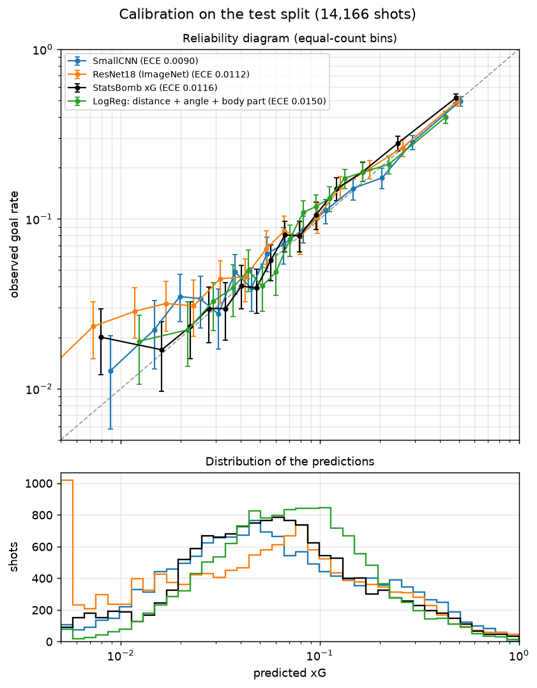
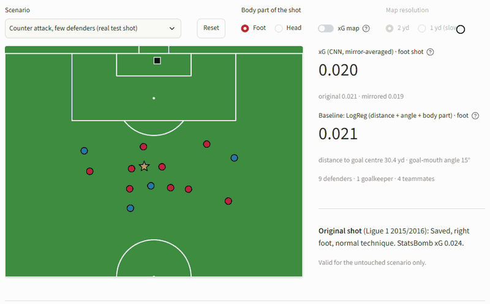

# xG-Vision: expected goals from a bird's-eye picture of the shot

## Project overview (25 s)

https://github.com/user-attachments/assets/9270343e-3f32-401a-9bf7-ccb810e2892d

**A 1.2 M-parameter CNN that reads only player positions and the body part gets within 0.005 log
loss of StatsBomb's own xG model and clearly beats distance/angle baselines, but StatsBomb's model
is still significantly better on held-out matches.**

Every shot becomes a 6-channel bird's-eye image of the attacking half built from the player
positions StatsBomb records at the moment of the shot (*freeze frames*). The
[interactive tactics board](#run-the-tactics-board-no-data-download-or-training-needed) lets you
drag players and see the xG change live.

| Test split (14,166 shots, 597 matches) | Log loss | Brier | ROC-AUC |
|---|---|---|---|
| StatsBomb xG (StatsBomb's own model) | **0.2778** [0.267, 0.289] | **0.0799** [0.076, 0.084] | **0.807** [0.795, 0.818] |
| **SmallCNN (this project)** | 0.2826 [0.272, 0.293] | 0.0813 [0.078, 0.085] | 0.797 [0.784, 0.809] |
| LogReg: distance + angle + body part | 0.3044 [0.293, 0.316] | 0.0879 [0.084, 0.092] | 0.753 [0.740, 0.766] |
| Constant (training goal rate) | 0.3478 | 0.0983 | 0.500 |

95% intervals from 2,000 bootstrap resamples of **matches**. Paired differences: SmallCNN −
StatsBomb log loss +0.0047 [+0.0023, +0.0071]; SmallCNN − LogReg −0.0218 [−0.0258, −0.0179].
All choices were made on the validation split; the test split was evaluated once.

**Contents:** [Method](#method) · [Results](#results) · [What the model learned](#what-the-model-learned) ·
[Interesting shots](#interesting-shots-grad-cam) · [Limitations](#limitations) ·
[Setup and usage](#setup-and-usage) · [License](#license-and-acknowledgements)

| Step | Content | Status |
|---|---|---|
| 1 | Data pipeline: StatsBomb Open Data → shot table, match-level split, multi-channel pitch tensors | ✅ |
| 2 | Models: small CNN from scratch vs. ImageNet ResNet18, body part as an extra input, early stopping | ✅ |
| 3 | Test evaluation: log loss / Brier / ROC-AUC, calibration, StatsBomb xG and LogReg baselines, Grad-CAM | ✅ |
| 4 | Sanity tests on every test shot and xG heat maps | ✅ |
| 5 | Interactive tactics board (Streamlit, drag and drop), weights and model card on the Hugging Face Hub | ✅ |
| 6 | (optional) Broadcast frame → player detection + homography → bird's-eye view → xG | ⏳ |

## Method

**Data.** [StatsBomb Open Data](https://github.com/statsbomb/open-data), all men's and women's
competitions with event data (snapshot November 2026): 3,961 matches, **95,160 open-play shots**
with a freeze frame, goal rate 10.4%. Penalties, free kicks and shots from the own half are
excluded. Split by match, stratified by competition: train 66,754 / val 14,240 / test 14,166.
The observed goal rate falls with distance and follows the mean StatsBomb xG closely, a check that
the data was read correctly:


**Pitch tensor.** Each shot becomes a `(6, 160, 120)` tensor of the attacking half
(x ∈ [60, 120], y ∈ [0, 80] yd, 0.5 yd per pixel), rendered on the fly (~1.2 ms per shot).
Left/right mirroring is the training augmentation.

| ch | content |
|---|---|
| 0 | shooter (Gaussian blob, σ = 1 yd) |
| 1 | attacking teammates |
| 2 | defending outfield players |
| 3 | defending goalkeeper |
| 4 | shooting cone: triangle from the shooter to both posts |
| 5 | static goal-distance map |


**Models.** `forward(image, body_part) -> logit`: the CNN turns the tensor into a feature vector
(global average pooling), the body part (head / foot / other) is concatenated, a small MLP head
outputs the goal logit.

| | SmallCNN | ResNet18 |
|---|---|---|
| Backbone | 5 × [conv-BN-ReLU × 2 + max-pool], 16–256 channels, from scratch | torchvision ResNet18, first conv rebuilt for 6 channels; ImageNet or random init |
| Parameters | 1.2 M | 11.2 M |

Plain binary cross-entropy (no class weights, to keep the probabilities calibrated), AdamW,
bf16, early stopping on the validation log loss. Batch-norm statistics are recomputed with frozen
weights before every validation ("precise BN"); the running averages had pushed the mean
prediction to 0.03–0.05 instead of the true 0.10.

## Results

All models on the test split (CNN rows: seed 42; full tables with Brier, per-gender results and
bootstrap details in [`results/metrics_test.md`](results/metrics_test.md)):

| Model | Log loss | ROC-AUC | 3 seeds (log loss) |
|---|---|---|---|
| StatsBomb xG | **0.2778** | **0.807** | – |
| SmallCNN | 0.2826 | 0.797 | 0.2824 ± 0.0006 |
| SmallCNN without the distance map | 0.2830 | 0.797 | 0.2828 ± 0.0009 |
| ResNet18, random init | 0.2832 | 0.797 | – |
| ResNet18, ImageNet | 0.2872 | 0.796 | – |
| LogReg: distance + angle + body part | 0.3044 | 0.753 | – |
| LogReg: distance + angle | 0.3131 | 0.728 | – |

- **The picture carries most of the signal:** +0.043 AUC over the distance/angle/body-part regression.
- **StatsBomb xG stays ahead** (also within men's and women's matches separately). It uses inputs the
  CNN does not see: shot technique, first-time, one-on-one, under pressure.
- **ImageNet pretraining does not help:** the ResNet18 from random initialisation is better in log
  loss (+0.0039 [+0.0013, +0.0066] for ImageNet; one seed each); the small CNN is as good as either.
- **The distance-map channel is redundant** (−0.0005 [−0.0023, +0.0015]); seeds hardly matter.
- Mirror test-time averaging helps slightly (0.2826 → 0.2822).

**Calibration.** All models are well calibrated (ECE: SmallCNN 0.009, StatsBomb 0.012, LogReg 0.015);
the CNN spreads its predictions more widely than the regression, which is where its better ranking
comes from. Error bars: match-bootstrap 95% intervals. Men / women:
[`calibration_test_by_gender.png`](results/plots/calibration_test_by_gender.png).

<p align="center"></p>

**Learning curves (validation).** The small CNN improves steadily and stops at epoch 9 of 14; the
ImageNet ResNet18 starts to overfit after epoch 5.

| SmallCNN | ResNet18 (ImageNet) |
|---|---|
|  |  |

## What the model learned

**Sanity tests.** Every one of the 14,166 test shots is edited in a controlled way (everyone else
stays put), re-rendered and re-scored. Out-of-distribution edits are marked **[OOD]**.

| Edit | Expected | In expected direction | Mean Δ xG |
|---|---|---|---|
| Defender 1.5 yd in front of the shooter | ↓ | 99.6% | −0.061 |
| Foot → head / head → foot | ↓ / ↑ | 100% / 100% | −0.050 / +0.071 |
| Goalkeeper 3 yd sideways, away from the shot line | ↑ | 89% | +0.059 |
| Shooter 3 yd closer to goal | ↑ | 85% | +0.091 |
| Shooter 3 yd farther away | ↓ | **67%** | −0.027 |
| Defender halfway along the shot line | ↓ | **64%** | −0.014 |
| Goalkeeper removed **[OOD]** | ↑ | 99% | +0.114 |

A control defender 6 yd beside the shot line changes xG less than the same defender in the cone
for 81% of shots. Details and diagnostics: [`results/sanity_test.md`](results/sanity_test.md).


**xG heat maps.** The shooter is moved over a 1 yd grid while the rest of a real test situation
stays fixed. In this crowded box, xG falls at 96% of the points inside the penalty area compared
with the same pitch without outfield players (by 0.13 on average, by up to 0.56 among the defenders):
the CNN reads the defence, which a distance/angle model cannot. At the penalty spot (foot):
LogReg 0.198 everywhere; CNN 0.378 with only a keeper, 0.250 in a counter-attack, 0.105 in this box.


More maps and tables: [`results/heatmaps.md`](results/heatmaps.md),
[`heatmap_empty.png`](results/plots/heatmap_empty.png), [`heatmap_counter.png`](results/plots/heatmap_counter.png).

## Interesting shots (Grad-CAM)

The test shots where the CNN and StatsBomb xG disagree most (3 goals and 3 non-goals per direction,
largest logit difference). StatsBomb rates some close-range half-volleys and first-time shots very
low; the CNN, which only sees positions, rates them high. Among the 5% of shots where the CNN is
much higher, volleys, half-volleys and lobs are more common than overall (37% vs. 23%): exactly
the information the picture lacks. Overlay: Grad-CAM of SmallCNN block 2 (chosen on validation).


Grad-CAM is of limited use here: with global average pooling the network also draws evidence from
*empty* space, and Grad-CAM only shows evidence for a goal, so defenders that lower xG never light
up. The sanity tests above probe the model more directly. Details:
[`results/interesting_test.md`](results/interesting_test.md).

## Limitations

1. **Goal-line edge artefact.** Shots from within ~1.5 yd of the goal line outside the posts get far
   too high xG (0.45 even 28 yd wide; LogReg 0.02). Only 112 training shots come from there and the
   shooter touches the edge of the tensor. The board hides the xG value there.
2. **Goalkeeper position is confounded with goals.** Moving only the keeper 2–4 yd off the line
   raises xG for more than 90% of test shots from beyond 8 yd (mean 0.072 → 0.110 at 4 yd; 0.19 →
   0.49 on an empty pitch). The data explain why: at the same distance, shots with the keeper further
   off the line go in far more often (12–18 yd: 5.9% with the keeper on the line, 29% at 6–10 yd;
   StatsBomb xG shows the same). A keeper off the line usually means a keeper out of position, so
   the model learned an association, not the effect of narrowing the angle.
3. **Out of distribution:** no goalkeeper (0.1% of training shots), only a goalkeeper on the pitch,
   headers from 25+ yd, set pieces. The board warns in these cases.
4. **Distance vs. pressure.** Stepping back raises xG for 27% of shots, mostly when it takes the
   shooter away from the nearest defender; the effect looks too large. A defender halfway along the
   shot line raises xG for 19% of shots, mostly 3–10 yd in front of the keeper.
5. **Left/right asymmetry** of up to 0.15 xG despite mirror augmentation (the board averages both).
6. **Only positions and the body part:** no technique, ball height, pass type or player skill.

## Setup and usage

Python 3.10+. Clone and create an environment:

```bash
git clone https://github.com/Huseyinyagmur/xG-Vision.git
cd xG-Vision
python -m venv .venv
.venv\Scripts\activate                        # Windows; Linux/macOS: source .venv/bin/activate
```

### Run the tactics board (no data download or training needed)

<p align="center">
  
</p>

```bash
pip install torch --index-url https://download.pytorch.org/whl/cpu   # or the CUDA build
pip install -r requirements-app.txt
streamlit run app/streamlit_app.py            # opens http://localhost:8501
```

The weights are downloaded from the Hugging Face Hub
([huseyinyagmur/xg-vision-smallcnn](https://huggingface.co/huseyinyagmur/xg-vision-smallcnn), with a
model card) unless `models/small_cnn/best.pt` exists, and the five real positions are fetched from
StatsBomb's own repository at start-up (this repository stores only their ids). *Move* mode drags
players, *Add* mode places a defender, teammate or goalkeeper with a click, a double-click removes a
player. xG is always the average of the situation and its mirror image; the regression baseline is
shown next to it. The xG map uses a 2 yd grid on a GPU (~1.5 s) and a 3 yd grid on a CPU;
`XG_DEVICE=cpu` forces the CPU.

There is **no hosted demo**: on Hugging Face, Gradio and Docker Spaces now require a paid plan, so
the board is meant to run locally with the commands above.


### Reproduce the whole project

```bash
pip install torch torchvision --index-url https://download.pytorch.org/whl/cu128   # GPU build
pip install -r requirements.txt

python -m src.data_download                   # ~3,961 matches into data/ (cached per match)
python -m src.visualize                       # data plots
python -m src.train --model small_cnn         # ~11 min on an RTX 4050 Laptop GPU (also: resnet18,
                                              #   resnet18_scratch, small_cnn_nodist, --seed 43)
python -m src.evaluate --split val            # metrics, bootstrap CIs, calibration
python -m src.interpret --compare-layers      # choose the Grad-CAM layer on validation
python -m src.evaluate --split test           # the test report (run once, at the end)
python -m src.interpret --split test          # disagreement shots with Grad-CAM
python -m src.sanity --split test             # sanity tests on every test shot (~2-3 min)
python -m src.heatmap                         # xG heat maps
python -m src.export_assets                   # scenario ids + LogReg coefficients for the board
python scripts/publish_model.py [--upload]    # weights + model card to the Hugging Face Hub
python scripts/record_demo.py                 # the tactics board GIF (needs playwright)
python scripts/ui_smoke.py                    # browser test of the board (needs playwright)
python -m pytest tests -q                     # tests needing data/shots.pkl are skipped without it
```

### Project layout

```
src/
  config.py         # paths, pitch geometry, channels, split, training/evaluation settings
  data_download.py  # StatsBomb -> shots + freeze frames -> clean table + match-level split
  pitch_tensor.py   # (shooter, freeze frame) -> (6, 160, 120) tensor
  dataset.py        # PyTorch Dataset (renders on the fly, mirror augmentation) + batch sampler
  features.py       # body part one-hot
  models.py         # SmallCNN, ResNet18xG, shared head, checkpoint loading
  train.py          # training loop, precise BN, early stopping, checkpoints
  baselines.py      # logistic regressions on distance + angle (+ body part)
  evaluate.py       # metrics, match-level bootstrap, calibration, reports
  gradcam.py        # Grad-CAM for the SmallCNN
  interpret.py      # Grad-CAM layer comparison, shots where the CNN and StatsBomb disagree
  perturb.py        # controlled edits of a shot (move shooter, add defender, move/remove keeper)
  sanity.py         # sanity tests over all test shots
  heatmap.py        # xG heat maps over a shooter grid
  board.py          # tactics board logic (coordinates, mirror-averaged model, warnings, xG map)
  export_assets.py  # scenario ids + LogReg coefficients for the board
  utils.py          # seeding, device, logging, memory-aware DataLoader workers
  visualize.py      # pitch plots, channel plots, calibration plots
app/                # Streamlit board + custom drag-and-drop component (board.js / board.css)
scripts/            # ui_smoke.py, record_demo.py, publish_model.py
deploy/hf_model/    # model card of the published weights
assets/             # StatsBomb logo
tests/              # renderer, mirroring, models, sampler, bootstrap/AUC, Grad-CAM, shot edits, board
results/            # metric reports (markdown + csv); plots/ holds the figures above
data/, models/      # downloaded data and trained weights (not in the repository)
```

## License and acknowledgements

The code is released under the [MIT License](LICENSE). The data is not: StatsBomb Open Data is
provided under the [StatsBomb Public Data User Agreement](https://github.com/statsbomb/open-data/blob/master/LICENSE.pdf),
which rules out commercial use of the data and of analysis derived from it and asks publications to
credit StatsBomb with its logo. The raw data is not redistributed here, and the published model
weights are shared for non-commercial research and education under those terms.

Data provided by [StatsBomb](https://github.com/statsbomb/open-data). Pitch plots:
[mplsoccer](https://github.com/andrewRowlinson/mplsoccer).


