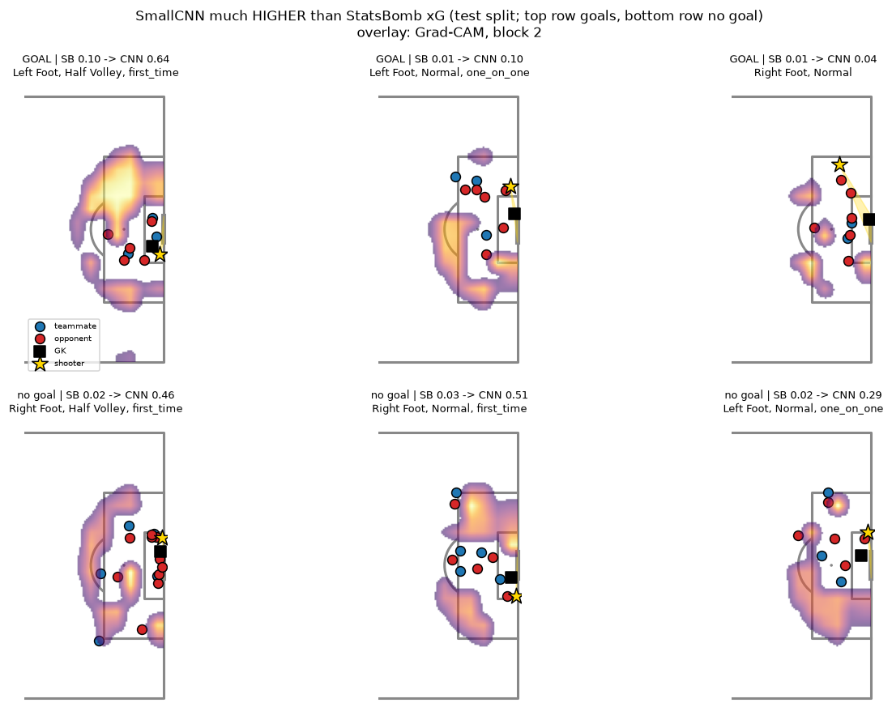
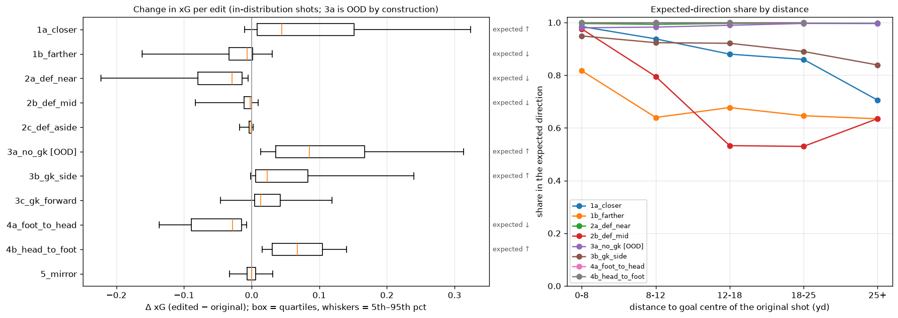
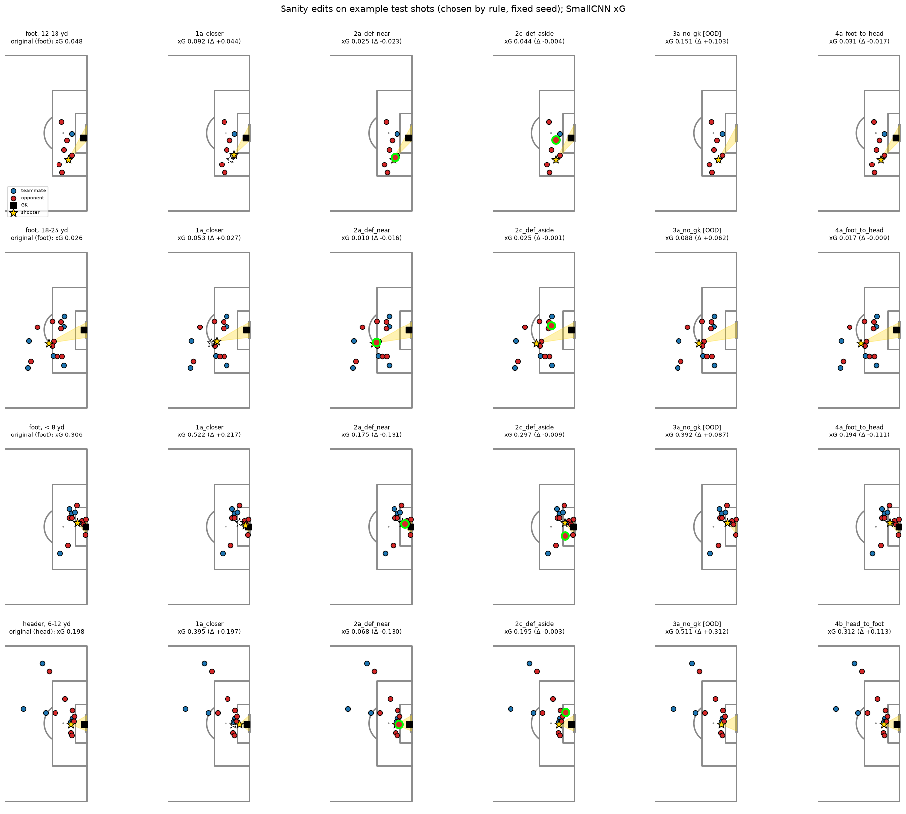
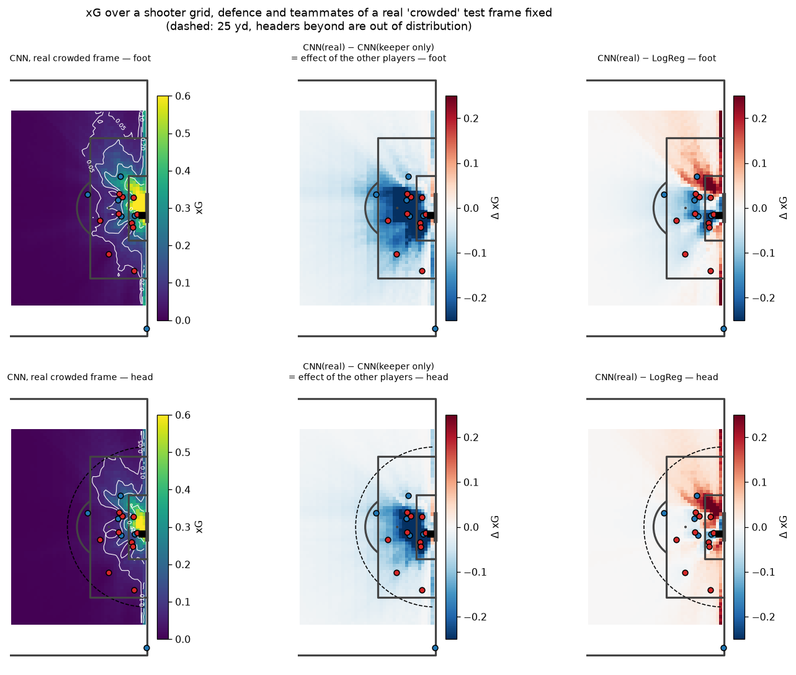
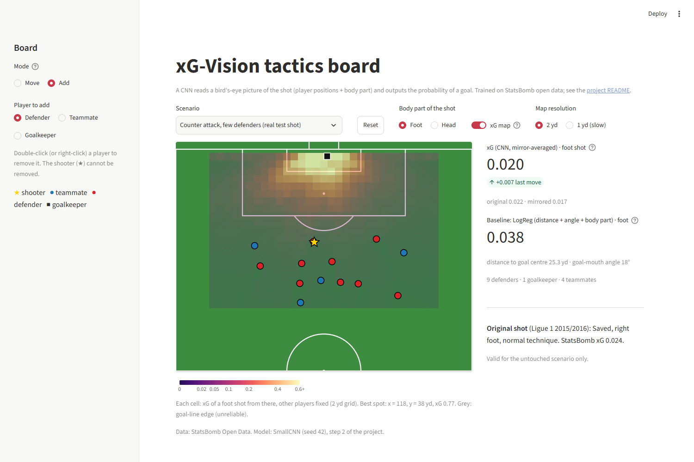
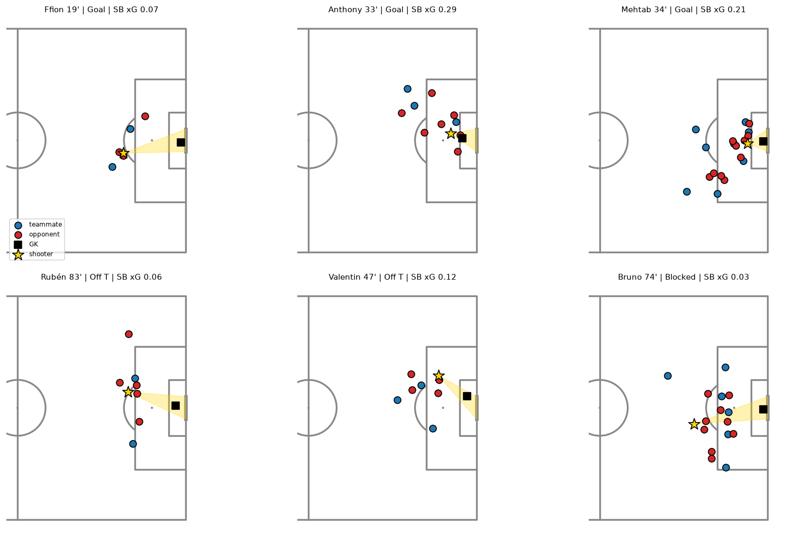

# xG-Vision: Expected Goals from bird's-eye freeze frames

Classic expected-goals (xG) models use hand-crafted features such as distance and angle to goal.
**xG-Vision** asks whether a convolutional network can learn shot quality directly from a
picture of the situation: every shot is turned into a multi-channel bird's-eye "image" of the
attacking half (the shooter, teammates, defenders, goalkeeper and the shooting cone), built from
the player positions StatsBomb records at the moment of the shot (*freeze frames*).

> **Status:** steps 1–4 are done: data pipeline, CNN training, a test-set evaluation
> against StatsBomb xG and logistic-regression baselines (match-level bootstrap CIs,
> calibration, Grad-CAM), and quantitative sanity tests with xG heat maps. **Headline:** from the pitch picture plus the body part, a 1.2 M
> parameter CNN gets within 0.005 log loss of StatsBomb's xG and clearly beats distance/angle
> baselines, but StatsBomb's model is still significantly better on the test split.

## Roadmap

| Step | Content | Status |
|---|---|---|
| 1 | Data pipeline: StatsBomb Open Data → cleaned shot table, match-level split, multi-channel pitch tensors, PyTorch `Dataset`, sanity plots | ✅ done |
| 2 | Models: small CNN from scratch vs. ImageNet ResNet18 (6-channel first conv), body part as an extra input, training loop with early stopping | ✅ done |
| 3 | Evaluation on the test split: log loss / Brier / ROC-AUC, calibration, comparison with StatsBomb xG and a distance + angle logistic regression, interesting shots, Grad-CAM | ✅ done |
| 4 | Sanity tests: move the shooter, add a defender in the shooting lane, remove the goalkeeper; xG heat map over the box | ✅ done |
| 5 | Interactive tactics board (Streamlit or Gradio): drag players, get xG live | 🚧 runs locally (incl. xG map layer); online demo next |
| 6 | (optional) Broadcast frame → player detection + pitch homography → bird's-eye view → xG | ⏳ planned |

## Data

[StatsBomb Open Data](https://github.com/statsbomb/open-data), all men's and women's
competitions with event data (snapshot downloaded November 2026).

| | |
|---|---|
| Matches | 3,961 |
| Open-play shots with a freeze frame | 95,160 |
| Goal rate | 10.4 % |
| Split (match-level, stratified by competition, 70/15/15) | train 66,754 · val 14,240 · test 14,166 shots |
| Reference: StatsBomb xG on the test split | log loss 0.278 · Brier 0.080 · ROC-AUC 0.807 |

Penalties are dropped. Free kicks (and a handful of corner and kick-off shots) stay in the
table but are excluded from training. The split is done by match, so no match appears in more
than one split.

## Pitch tensor

Each shot becomes a `(6, 160, 120)` tensor covering the attacking half
(x ∈ [60, 120], y ∈ [0, 80] StatsBomb yards, 0.5 yd per pixel). Tensors are rendered on the fly
in the `Dataset` (~1.2 ms per shot on one CPU core; each player's Gaussian is only evaluated in a
small window around it) instead of being stored. Mirroring the pitch left/right is used as a
training augmentation; a test checks that it equals flipping the tensor rows.

| ch | content |
|---|---|
| 0 | shooter (Gaussian blob, σ = 1 yd) |
| 1 | attacking teammates |
| 2 | defending outfield players |
| 3 | defending goalkeeper |
| 4 | shot cone: triangle from the shooter to both posts (binary) |
| 5 | static goal-distance map (CoordConv-style positional prior) |


## Models

Both models share the interface `forward(image, extra) -> logit`: the CNN turns the pitch
tensor into a feature vector (global average pooling), the body part (head / foot / other,
one-hot) is concatenated, and a small MLP head outputs the goal logit. Left and right foot are
merged so that the mirror augmentation stays valid.

| | SmallCNN | ResNet18 |
|---|---|---|
| Backbone | 5 × [conv-BN-ReLU × 2 + max-pool], 16-32-64-128-256 channels, from scratch | torchvision ResNet18, ImageNet weights; first conv rebuilt for 6 channels (mean RGB filter, rescaled) |
| Parameters | 1.2 M | 11.2 M |
| Learning rate | 1e-3 | 1e-3 head and first conv, 1e-4 pretrained layers |

Training: plain binary cross-entropy (no class weights, to keep probabilities calibrated),
AdamW, LR halved on a val plateau, bf16 mixed precision, batch 256, early stopping on the
validation log loss (patience 5). Before every validation the BatchNorm statistics are
recomputed with the frozen weights ("precise BN"): the running averages lag behind the weights
and had pushed the mean predicted xG to 0.03–0.05 instead of the true goal rate of 0.10.

## Results (test split)

All choices (models, epochs, Grad-CAM layer) were fixed on the validation split first; the
test split was evaluated once. Test: 14,166 open-play shots from 597 matches, goal rate 0.1105.
95% intervals come from 2,000 bootstrap resamples **of matches** (shots of one match are not
independent). CNN rows are the seed-42 runs.

| Model | Log loss | Brier | ROC-AUC | Log loss, 3 seeds (mean ± std) |
|---|---|---|---|---|
| StatsBomb xG | **0.2778** [0.267, 0.289] | **0.0799** | **0.807** [0.795, 0.818] | – |
| SmallCNN | 0.2826 [0.272, 0.293] | 0.0813 | 0.797 [0.784, 0.809] | 0.2824 ± 0.0006 |
| SmallCNN, no distance map | 0.2830 | 0.0818 | 0.797 | 0.2828 ± 0.0009 |
| ResNet18, random init | 0.2832 | 0.0814 | 0.797 | (1 seed) |
| ResNet18, ImageNet | 0.2872 | 0.0826 | 0.796 | (1 seed) |
| LogReg: distance + angle + body part | 0.3044 | 0.0879 | 0.753 | – |
| LogReg: distance + angle | 0.3131 | 0.0903 | 0.728 | – |
| Constant (training goal rate) | 0.3478 | 0.0983 | 0.500 | – |

Paired match-bootstrap differences (a − b, 95% CI):

| Comparison | Δ log loss | Δ ROC-AUC | Reading |
|---|---|---|---|
| SmallCNN − StatsBomb xG | +0.0047 [+0.0023, +0.0071] | −0.010 [−0.015, −0.005] | StatsBomb is better (also within men's and women's matches) |
| SmallCNN − LogReg (dist + angle + body) | −0.0218 [−0.0258, −0.0179] | +0.043 [+0.035, +0.051] | the CNN learns much more than distance and angle |
| SmallCNN − ResNet18 (ImageNet) | −0.0046 [−0.0075, −0.0017] | +0.000 [−0.005, +0.006] | the small CNN is better calibrated; same ranking |
| ResNet18 ImageNet − random init | +0.0039 [+0.0013, +0.0066] | −0.000 [−0.005, +0.004] | ImageNet pretraining does **not** help (see below) |
| SmallCNN − no distance map | −0.0005 [−0.0023, +0.0015] | −0.001 [−0.004, +0.003] | no meaningful difference |

By gender (SmallCNN / StatsBomb, log loss): men 0.2752 / 0.2704, women 0.2960 / 0.2914.
Full tables, including Brier, per-gender metrics and the bootstrap details:
[`results/metrics_test.md`](results/metrics_test.md) (validation: [`results/metrics_val.md`](results/metrics_val.md)).

**What this means**

- **The picture carries most of the signal.** With only player positions and the body part, the
  CNN beats a distance + angle + body-part logistic regression by 0.022 log loss and 0.043 AUC.
- **StatsBomb xG remains ahead** (0.005 log loss, 0.010 AUC, both significant). Its model also
  uses inputs the CNN does not get, such as shot technique (volley, lob…) and the first-time,
  one-on-one and under-pressure flags. Among the 5% of shots where the CNN is much *higher* than
  StatsBomb, non-"Normal" techniques (volleys, half-volleys, lobs) are more common than overall
  (37% vs. 23%): information the picture does not contain.
- **Pretraining did not help.** ImageNet ResNet18 is worse than the same network from random
  initialisation in log loss and Brier (AUC identical). The difference exceeds 0.003 but comes
  from a single seed and a different learning-rate setup (1e-4 on the pretrained layers), so the
  safe reading is "ImageNet features bring no benefit for these synthetic images". The 1.2 M
  parameter SmallCNN is as good as either ResNet18.
- **The distance map channel is redundant**: without it the SmallCNN is equally good (3 seeds
  each). The network infers position from the shooter blob and the shot cone.
- **Seeds hardly matter**: three SmallCNN seeds differ by ±0.0006 log loss on test.
- **Test-time mirroring** (average of the shot and its mirror image) gives a small gain
  (SmallCNN 0.2826 → 0.2822); it is reported separately and not used above.
- The val → test drop (StatsBomb 0.263 → 0.278) affects all models alike: the test split has a
  higher goal rate (11.1% vs. 10.3%), which raises log loss for every model.

### Calibration

Equal-count bins on log axes; error bars are match-bootstrap 95% intervals. All models are well
calibrated (ECE: SmallCNN 0.009, ResNet18 0.011, StatsBomb 0.012, LogReg 0.015). The CNN's
predictions are spread more widely than the logistic regression's, which is where its better
ranking comes from. ImageNet ResNet18 puts ~6% of the shots below 0.005 xG and is slightly
overconfident there. Per-gender panels:
[`calibration_test_by_gender.png`](results/plots/calibration_test_by_gender.png).


### Where the CNN and StatsBomb disagree (with Grad-CAM)

For each direction, the 3 goals and 3 non-goals with the largest logit difference between the
SmallCNN and StatsBomb xG. Overlay: Grad-CAM of SmallCNN block 2 (20 × 15 feature map, chosen on
validation shots, see [`gradcam_layers_val.png`](results/plots/gradcam_layers_val.png)).




Typical cases: StatsBomb rates some close-range half-volleys and first-time shots very low,
while the CNN, which only sees the positions, rates them high. Conversely, shots that StatsBomb
rates near 1.0 (an empty net, one-on-ones) are capped around 0.7–0.8 by the CNN.
Details: [`results/interesting_test.md`](results/interesting_test.md).

**Grad-CAM caveat.** The maps are of limited use here. Because the network ends in global
average pooling, it also draws evidence from *empty* areas, and the maps often highlight the
free space around the player cluster rather than single players. Grad-CAM also only shows
positive evidence (for a goal), so a defender who lowers xG never lights up, and when nothing
pushes the logit up, the map is empty. Step 4 tests the model's behaviour directly by moving
players.

### Step 2: training (validation split)

| Model | Val log loss | Best / last epoch | Training time |
|---|---|---|---|
| SmallCNN (3 seeds) | 0.2654 ± 0.0002 | 9–11 / 14–16 | 11–13 min |
| SmallCNN, no distance map (3 seeds) | 0.2655 ± 0.0005 | 8–11 / 13–16 | 11–13 min |
| ResNet18, random init | 0.2654 | 9 / 14 | 12 min |
| ResNet18, ImageNet | 0.2690 | 5 / 10 | 8 min |

The pretrained ResNet18 starts to overfit after epoch 5, while the small CNN improves steadily:


## Sanity tests (step 4)

Does the CNN react to the situation the way football logic says it should? Every one of the
14,166 test shots is edited in a controlled way, re-rendered and re-scored by the SmallCNN
(seed 42); everyone else stays where they are. A change smaller than 0.001 counts as "no
change". Situations that (almost) never occur in training are flagged **OOD** and kept apart:
shots without a goalkeeper (0.1% of the data) and headers from 25+ yd.

| Edit | Shots | Expected | In expected direction | Opposite | Mean Δ xG |
|---|---|---|---|---|---|
| 1a shooter 3 yd closer to the goal centre | 13,909 | ↑ | 85% | 12% | +0.091 |
| 1b shooter 3 yd farther away | 14,138 | ↓ | **67%** | **27%** | −0.027 |
| 2a defender 1.5 yd in front of the shooter, on the shot line | 14,143 | ↓ | 99.6% | 0.2% | −0.061 |
| 2b defender halfway along the shot line | 14,146 | ↓ | **64%** | **19%** | −0.014 |
| 3a goalkeeper removed **[OOD]** | 14,147 | ↑ | 99% | 1% | +0.114 |
| 3b goalkeeper 3 yd sideways, away from the shot line | 10,843 | ↑ | 89% | 6% | +0.059 |
| 4a foot → head (same position) | 8,504 | ↓ | 100% | 0% | −0.050 |
| 4b head → foot | 2,335 | ↑ | 100% | 0% | +0.071 |

- **Control (2c).** The halfway defender moved 6 yd sideways, out of the shooting cone, changes
  xG less than the same defender in the cone, in front of the shooter (2a) *and* halfway (2b),
  for 81% of shots. It still lowers xG slightly in 84% of them (mean −0.003); a defender nearby
  plausibly adds pressure.
- **Goalkeeper 3 yd forward (3c, no expected direction).** xG mostly *rises* (+0.024 on
  average, up for 79–95% of shots beyond 8 yd). In the data a goalkeeper off the line often
  means a beaten or rushing keeper, and the model has learned that association.
- **Mirror symmetry (5).** The mirrored input is exactly the row-flipped tensor, yet predictions
  differ by 0.012 on average (95th percentile 0.045, max 0.15), despite mirror augmentation in
  training. This is why mirror test-time augmentation helps a little.
- **CNN vs. LogReg.** The logistic regression always moves in the expected direction when the
  shooter moves (99.7%), as it must, since it only sees distance and angle. The CNN weighs
  position against the surrounding defenders.



Example shots (one per category, chosen by a fixed-seed rule, not by hand), with the edited
situation and the new xG:



### xG heat maps

The shooter is moved over a 1 yd grid (x 78–119, y 10–70) while the rest of the situation stays
fixed: (a) only a goalkeeper on the goal line (OOD: no outfield players), (b) the defence and
teammates of two real test frames, chosen by rule: a crowded box (10 defenders) and a counter
(at most 2 defenders within 30 yd). Foot and head are mapped separately.

| xG at the penalty spot (108, 40), foot | |
|---|---|
| LogReg (distance + angle + body part), any frame | 0.198 |
| CNN, keeper only | 0.378 |
| CNN, counter frame | 0.250 |
| CNN, crowded frame | 0.105 |

The defence is clearly taken into account: in the crowded frame, xG falls at 96% of the
grid points inside the box (by 0.13 on average, by up to 0.56 among the defenders in front of goal) and in
the counter frame at 84% of them. With no outfield players at all, the CNN is far above the
logistic regression, which averages over typical defences.



Keeper-only maps, the counter frame and all tables: [`results/heatmaps.md`](results/heatmaps.md),
[`heatmap_empty.png`](results/plots/heatmap_empty.png),
[`heatmap_counter.png`](results/plots/heatmap_counter.png). Sanity tables:
[`results/sanity_test.md`](results/sanity_test.md).

### Unexpected behaviour

Real inconsistencies (in-distribution situations):

1. **Stepping back can raise xG.** Moving the shooter 3 yd away raises xG for 27% of shots. These
   cases concentrate where the move takes the shooter away from the nearest defender (34% wrong
   when the gap grows by > 1 yd, 5% when it shrinks). Likewise, moving closer goes wrong mostly
   when it brings the shooter onto a defender (24% vs. 5%). The trade-off between distance and
   pressure is reasonable, but its size (up to +0.17 xG for stepping back) looks too large.
2. **A defender halfway to goal sometimes raises xG** (19% of shots). This happens mostly when the
   added defender stands 3–10 yd in front of the goalkeeper (27–34%), rarely when it stands next to the
   keeper (7%). A screened goalkeeper is a possible but unverified
   explanation.
3. **Goal-line edge artefact.** On the empty pitch, shooters 1 yd from the goal line get high xG
   even 28 yd wide of the goal (0.45 at x = 119 vs. 0.08 at x = 118, LogReg 0.02). Only 112
   training shots come from there (x ≥ 118.5, wide of the posts), and the shooter blob touches
   the edge of the tensor. Shots from such positions should not be trusted.
4. **Left/right asymmetry** of up to 0.12 xG on the empty pitch (at (113, 33)) and 0.15 on real
   shots, see above.

5. **Goalkeeper position is confounded with goals.** Moving only the goalkeeper 2–4 yd off the line
   towards the shooter raises xG for more than 90% of test shots from beyond 8 yd (mean xG of
   11,659 shots: 0.072 → 0.094 → 0.110 at 2 and 4 yd). It happens in single situations as well:
   0.19 → 0.49 on the empty pitch (6 yd), 0.020 → 0.033 in the counter frame and 0.078 → 0.118 in
   the crowded frame (2 yd). Only a keeper right next to the shooter lowers it. The training data
   explain why: at the same shot distance, shots with the keeper further off the line go in far
   more often (12–18 yd: 5.9% with the keeper within 1 yd of the line, 29% at 6–10 yd; StatsBomb
   xG shows the same pattern). A keeper off the line usually means a keeper out of position
   (rebounds, cut-backs, rushed one-on-ones), so the model has learned an association, not the
   effect of a keeper deliberately narrowing the angle. On the tactics board, moving only the
   keeper therefore gives misleading answers.

Out-of-distribution results, reported for completeness: removing the goalkeeper raises xG for
99% of shots (+0.11) and the keeper-only maps are far above LogReg; both are plausible in
direction but the model has (almost) never seen these situations. Headers from 25+ yd behave
like foot shots scaled down.

A limitation of the test design: for a shot from an angle, moving the goalkeeper perpendicular
to the shot line also pushes the keeper towards the goal line; moves that would end behind it are
skipped (3,303 shots), and the largest wrong-direction 3b cases are of this kind
([`sanity_failures_test.png`](results/plots/sanity_failures_test.png)).

## Tactics board (step 5)

A Streamlit app where players can be dragged on a bird's-eye view of the attacking half; the
CNN's xG updates after every move. xG is always mirror-averaged (the situation and its mirror
image), the LogReg baseline is shown next to it, and the panel shows the change caused by the
last move. Five real test-set situations (chosen by rule) and an empty pitch are built in.
Warnings appear where step 4 found the model unreliable: no goalkeeper, a goalkeeper alone,
headers from 25+ yd, and the goal-line edge outside the posts, where the xG value is hidden
altogether. A note appears when the keeper is off the line (see limitation 5 above).

The optional **xG map** layer colours every spot by the xG a shot from there would get with the
other players where they are (2 yd grid by default, 1 yd on request; square-root colour scale).
It only depends on the non-shooters, so it is cached per defence and dragging the shooter does
not recompute it (2 yd: ~1.5 s, 1 yd: ~5 s on an RTX 4050 Laptop GPU).

```bash
pip install -r requirements-app.txt
python -m src.export_assets            # once: scenarios + LogReg coefficients -> app/assets/ (already in the repo)
streamlit run app/streamlit_app.py     # needs models/small_cnn/best.pt
python scripts/ui_smoke.py             # optional browser test (pip install playwright; uses Edge/Chrome)
```

The drag-and-drop board is a small custom Streamlit component (`app/board.js`, components v2,
no build step): *Move* mode drags players, *Add* mode places a defender, teammate or goalkeeper
with a click, and a double-click removes a player.



## Plots

**Data sanity check.** The observed goal rate falls with distance and closely follows the mean
StatsBomb xG. Shot and goal locations concentrate in the penalty box.


**Example freeze frames** from the training split (top row goals, bottom row misses).



## Setup

Requires Python 3.10+.

```bash
git clone https://github.com/Huseyinyagmur/xG-Vision.git
cd xG-Vision
python -m venv .venv
.venv\Scripts\activate          # Windows; on Linux/macOS: source .venv/bin/activate

# With an NVIDIA GPU, install the CUDA build of PyTorch first, e.g.:
pip install torch torchvision --index-url https://download.pytorch.org/whl/cu128
pip install -r requirements.txt
```

## Usage

```bash
python -m src.data_download                    # full dataset into data/ (~3,961 matches, cached per match)
python -m src.data_download --max-matches 50   # quick smoke test
python -m src.visualize                        # writes the plots to results/plots/
python -m src.evaluate                         # reference metrics (StatsBomb xG, constant) on val/test

python -m src.train --model small_cnn          # ~11 min on an RTX 4050 Laptop GPU
python -m src.train --model resnet18           # ~8 min
python -m src.train --model small_cnn --subset 15000 --epochs 3   # quick smoke test
python -m src.train --model small_cnn --seed 43                  # other seeds -> models/small_cnn_s43/
python -m src.train --model resnet18_scratch                     # ablations (also: small_cnn_nodist)

python -m src.baselines                        # logistic-regression baselines on val
python -m src.evaluate --split val             # full report: metrics, bootstrap CIs, calibration plots
python -m src.interpret --compare-layers       # Grad-CAM at several layers (val), to choose GRADCAM_LAYER
python -m src.evaluate --split test            # same report on the test split (run once, at the end)
python -m src.interpret --split test           # disagreement shots with Grad-CAM
python -m src.sanity --split test              # step 4: sanity tests on every test shot (~2-3 min)
python -m src.heatmap                          # step 4: xG heat maps (< 1 min)
streamlit run app/streamlit_app.py             # step 5: tactics board

python -m pytest tests -q                      # tests needing data/shots.pkl are skipped without it
```

Each run writes `models/<run>/` (`best.pt`, `last.pt`, `history.csv`, `train.log`,
`val_predictions.csv`) and `results/plots/training_curves_<run>.png`. The evaluation writes
`results/metrics_<split>.md|csv`, `results/interesting_<split>.md` and the plots in `results/plots/`.

```python
from src.dataset import load_shots, ShotDataset
from src.models import load_checkpoint

train = load_shots("train")                    # open-play shots of the training split
x, extra, y, _ = ShotDataset(train, augment=True)[0]
x.shape, extra                                 # torch.Size([6, 160, 120]), body part one-hot

model, ckpt = load_checkpoint("models/small_cnn/best.pt")
xg = model(x[None], extra[None]).sigmoid()     # P(goal)
```

On Google Colab, put the project on Google Drive (see the comment in `src/config.py`) so the
download cache survives runtime resets.

## Project layout

```
src/
  config.py         # paths, pitch geometry, resolution, channels, split
  data_download.py  # StatsBomb -> shots + freeze frames -> clean table + match-level split
  pitch_tensor.py   # (shooter, freeze frame) -> (6, 160, 120) tensor
  dataset.py        # PyTorch Dataset (renders on the fly, mirror augmentation) + phase batch sampler
  features.py       # scalar model inputs (body part one-hot)
  models.py         # SmallCNN, ResNet18xG, shared head, checkpoint loading
  train.py          # training loop, precise BN, early stopping, checkpoints
  baselines.py      # logistic regressions on distance + angle (+ body part)
  evaluate.py       # metrics (+ by gender), match-level bootstrap, calibration, reports
  gradcam.py        # Grad-CAM for the SmallCNN
  interpret.py      # Grad-CAM layer comparison, shots where CNN and StatsBomb disagree
  perturb.py        # controlled edits of a shot (move shooter, add defender, move/remove keeper...)
  sanity.py         # sanity tests over all test shots, diagnostics, plots
  heatmap.py        # xG heat maps over a shooter grid, CNN vs. LogReg
  board.py          # tactics board logic: pixel <-> yard mapping, TTA model, LogReg from JSON, warnings
  export_assets.py  # scenarios + LogReg coefficients for the app
app/                # Streamlit app + drag-and-drop component (board.js / board.css), assets/*.json
scripts/ui_smoke.py # optional end-to-end browser test of the board
  utils.py          # seeding, device, log file
  visualize.py      # pitch plots, channel plots, data overview
tests/              # renderer vs. reference, mirror = row flip, models, sampler, bootstrap/AUC, Grad-CAM, shot edits
results/            # metric reports (markdown + csv); plots/ holds the figures shown above
data/, models/      # downloaded data and trained weights (not in the repo)
```

## Acknowledgements

Data: [StatsBomb Open Data](https://github.com/statsbomb/open-data). Pitch plots:
[mplsoccer](https://github.com/andrewRowlinson/mplsoccer).
