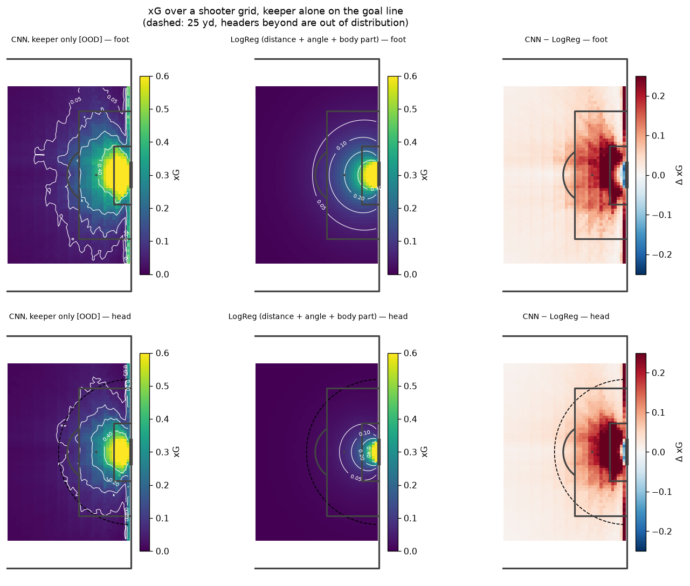
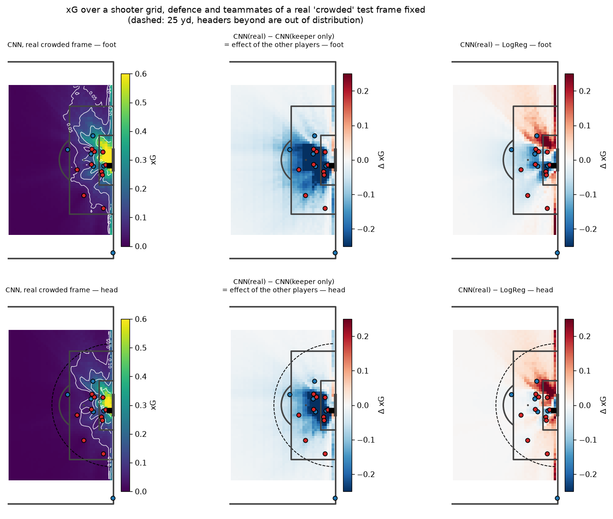
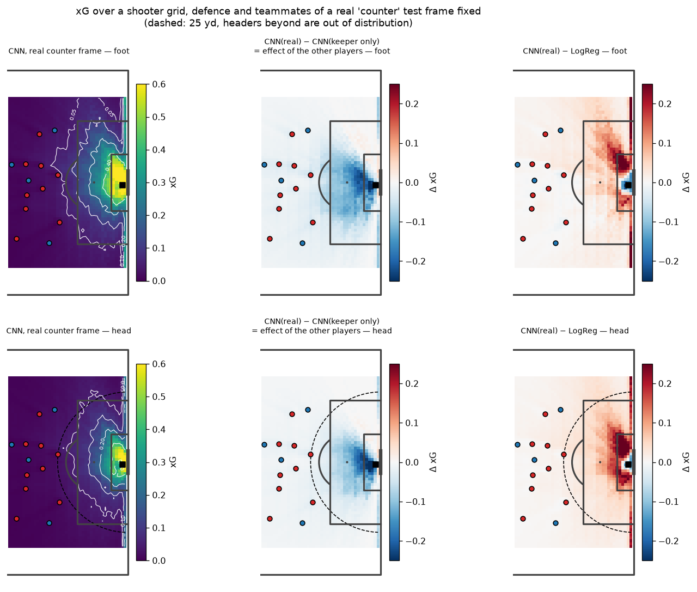

# xG heat maps

Model `small_cnn` (seed 42). Shooter grid x ∈ [78, 119], y ∈ [10, 70], 1 yd steps (42 × 61 points). The keeper-only scenario is out of distribution (no outfield players never occurs in training); headers from 25+ yd are out of distribution too. Generated by `python -m src.heatmap`.

Real frames (chosen by rule from the test split, fixed seed):

| frame | shot_id | outfield defenders | teammates |
|---|---|---|---|
| crowded | e0561948-2112-40db-a062-32e15e5a8211 | 10 | 6 |
| counter | 3d76d40e-8bcd-4338-b5f9-2fe52a28dd9d | 9 | 4 |

## xG at reference points

| point | LogReg foot | CNN empty foot | CNN crowded foot | CNN counter foot | LogReg head | CNN empty head | CNN crowded head | CNN counter head |
|---|---|---|---|---|---|---|---|---|
| 6-yd box centre (114, 40) | 0.496 | 0.748 | 0.446 | 0.543 | 0.216 | 0.616 | 0.308 | 0.391 |
| penalty spot (108, 40) | 0.198 | 0.378 | 0.105 | 0.250 | 0.065 | 0.250 | 0.061 | 0.148 |
| edge of box, centre (102, 40) | 0.091 | 0.162 | 0.032 | 0.095 | 0.027 | 0.086 | 0.021 | 0.056 |
| edge of box, wide (102, 25) | 0.043 | 0.096 | 0.064 | 0.073 | 0.012 | 0.058 | 0.041 | 0.047 |
| tight angle (116, 30) | 0.148 | 0.373 | 0.327 | 0.383 | 0.046 | 0.247 | 0.211 | 0.256 |
| 25 yd, centre (95, 40) | 0.039 | 0.060 | 0.009 | 0.037 | 0.011 | 0.038 | 0.006 | 0.024 |

## Mirror asymmetry of the keeper-only map (about y = 40)

| map | mean |p(y) − p(80−y)| | max | at (x, y) | p there | p mirrored |
|---|---|---|---|---|---|
| CNN, foot | 0.0113 | 0.1184 | (113, 33) | 0.5000 | 0.3816 |
| CNN, head | 0.0078 | 0.1035 | (113, 33) | 0.3568 | 0.2533 |
| LogReg, foot | 0.0000 | 0.0000 | (78, 10) | 0.0020 | 0.0020 |

## Monotonicity between the posts (keeper-only map)

Between the posts, every 1 yd step towards the goal line is closer and wider; xG should not fall.

| map | steps | share falling > 0.001 | share falling > 0.01 | falls > 0.01 at x >= 117 | largest fall |
|---|---|---|---|---|---|
| CNN, foot | 287 | 0.1324 | 0.0279 | 8 | 0.1216 |
| CNN, head | 287 | 0.0941 | 0.0279 | 8 | 0.1518 |
| LogReg, foot | 287 | 0.0000 | 0.0000 | 0 | 0.0000 |

## Goal-line edge (keeper-only map, foot)

The last grid column (x = 119) lies 1 yd from the goal line, at the right edge of the tensor.

| y (wide of the posts) | CNN x=115 | CNN x=117 | CNN x=118 | CNN x=119 | LogReg x=119 |
|---|---|---|---|---|---|
| 12 | 0.033 | 0.036 | 0.082 | 0.454 | 0.019 |
| 20 | 0.090 | 0.055 | 0.078 | 0.431 | 0.043 |
| 28 | 0.266 | 0.142 | 0.140 | 0.295 | 0.097 |

Training shots with x >= 118.5 and |y − 40| >= 8: 112 of 66,754 (goal rate 0.05).

## Effect of the real players inside the penalty box

| frame | body | mean Δ in box | share of box points lower | share higher | largest drop | at (x, y) | largest rise |
|---|---|---|---|---|---|---|---|
| crowded | foot | -0.127 | 0.956 | 0.043 | -0.559 | (115, 42) | 0.107 |
| crowded | head | -0.090 | 0.954 | 0.042 | -0.538 | (115, 42) | 0.103 |
| counter | foot | -0.065 | 0.837 | 0.127 | -0.341 | (117, 41) | 0.057 |
| counter | head | -0.050 | 0.840 | 0.096 | -0.383 | (117, 41) | 0.051 |

