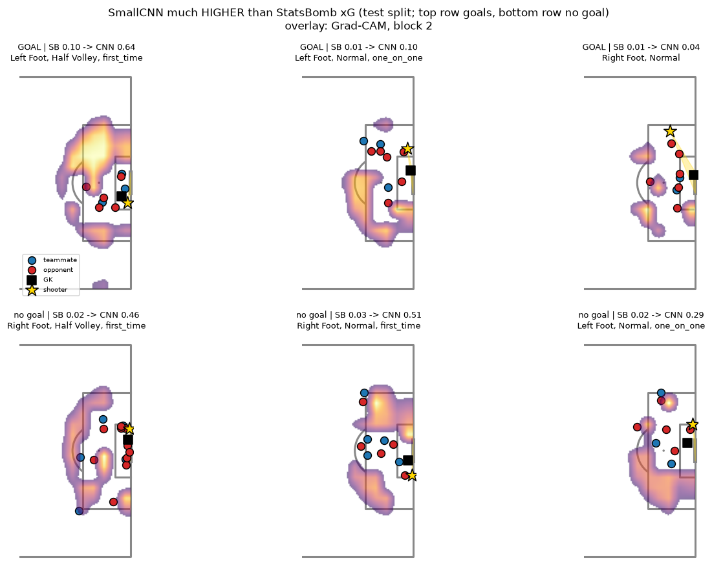
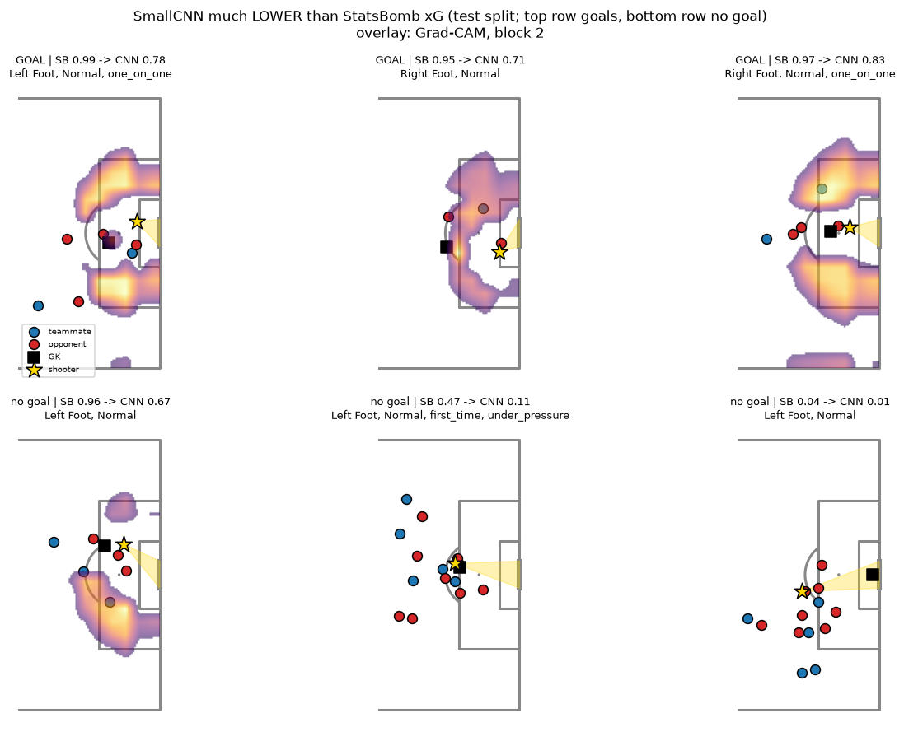

# Shots where SmallCNN and StatsBomb xG disagree most (test split)

Selection: largest |logit(p_CNN) − logit(p_StatsBomb)| per direction, 3 goals and 3 non-goals each. Grad-CAM layer: SmallCNN block 2.

| direction | outcome | SB xG | CNN xG | distance (yd) | body part | technique | first time | one on one | under pressure | competition | shot_id |
|---|---|---|---|---|---|---|---|---|---|---|---|
| cnn_higher | goal | 0.104 | 0.641 | 7.694 | Left Foot | Half Volley | True | False | False | La Liga | eabe63ae-b505-4148-af07-7f87bc9b8b78 |
| cnn_higher | goal | 0.013 | 0.099 | 13.086 | Left Foot | Normal | False | True | False | Premier League | dd597b28-39fe-4f69-8f41-cdbaca073174 |
| cnn_higher | goal | 0.008 | 0.045 | 21.691 | Right Foot | Normal | False | False | False | La Liga | 3c6c1686-11ee-4466-91eb-6da68703296e |
| cnn_higher | no goal | 0.015 | 0.459 | 8.310 | Right Foot | Half Volley | True | False | False | Women's World Cup | 1f0f284e-5898-4583-b014-8cc7ad26694d |
| cnn_higher | no goal | 0.034 | 0.510 | 9.413 | Right Foot | Normal | True | False | False | Premier League | f90a9de2-787c-4ac6-b1f4-7fefde85c7f6 |
| cnn_higher | no goal | 0.018 | 0.289 | 10.050 | Left Foot | Normal | False | True | False | NWSL | 8d9493b2-69e4-4cc9-b1c6-64679d0d58c3 |
| cnn_lower | goal | 0.986 | 0.784 | 7.648 | Left Foot | Normal | False | True | False | Frauen Bundesliga | c6a54b2e-9109-4743-af56-d9e57bca848d |
| cnn_lower | goal | 0.953 | 0.713 | 8.207 | Right Foot | Normal | False | False | False | Frauen Bundesliga | ce542a02-5014-4f47-a941-230ec31e4760 |
| cnn_lower | goal | 0.971 | 0.832 | 8.865 | Right Foot | Normal | False | True | False | Women's World Cup | fd7e3583-180d-48c8-8861-2324c6b06bb3 |
| cnn_lower | no goal | 0.961 | 0.672 | 14.046 | Left Foot | Normal | False | False | False | Ligue 1 | 0e8658af-b69d-4a46-ad2f-6b04cdef2299 |
| cnn_lower | no goal | 0.470 | 0.114 | 19.499 | Left Foot | Normal | True | False | True | Premier League | f36996e9-06fe-4e5a-8954-2c7be838b926 |
| cnn_lower | no goal | 0.042 | 0.007 | 23.537 | Left Foot | Normal | False | False | False | FA Women's Super League | d13c005d-b58b-4799-b486-e5770396681f |

## StatsBomb-only attributes among the strongest disagreements

Share of shots with each attribute. These inputs are used by StatsBomb's model but not by the CNN.

| group | shots | goal rate | mean SB xG | first_time | one_on_one | under_pressure | header | technique not 'Normal' | Volley | Half Volley | Lob |
|---|---|---|---|---|---|---|---|---|---|---|---|
| all shots | 14166 | 0.110 | 0.101 | 0.326 | 0.053 | 0.259 | 0.165 | 0.234 | 0.066 | 0.145 | 0.010 |
| top 5% CNN higher | 708 | 0.100 | 0.068 | 0.412 | 0.106 | 0.169 | 0.071 | 0.370 | 0.116 | 0.185 | 0.028 |
| top 5% CNN lower | 708 | 0.106 | 0.112 | 0.226 | 0.017 | 0.335 | 0.112 | 0.127 | 0.016 | 0.093 | 0.011 |

