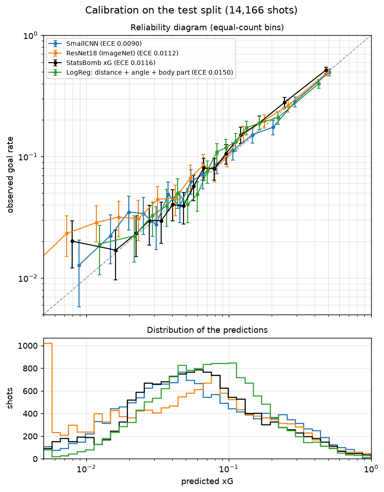
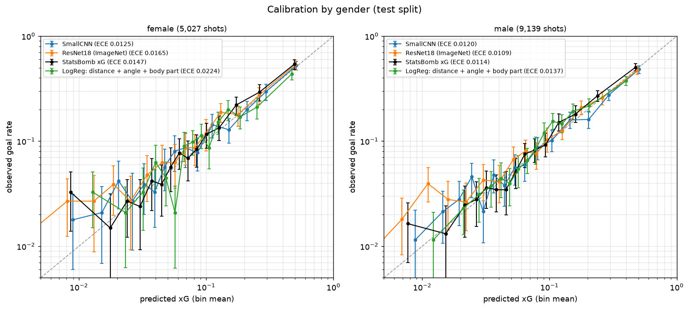

# Results on the test split

14,166 open-play shots from 597 matches, goal rate 0.1105. CNN rows are the seed-42 runs; the epoch of every CNN was selected on the validation split. Generated by `python -m src.evaluate --split test`.

## Metrics (all)

| model | log loss | Brier | ROC-AUC | mean xG | goal rate | shots |
|---|---|---|---|---|---|---|
| SmallCNN | 0.2826 | 0.0813 | 0.7966 | 0.1096 | 0.1105 | 14166 |
| ResNet18 (ImageNet) | 0.2872 | 0.0826 | 0.7962 | 0.0995 | 0.1105 | 14166 |
| ResNet18 (random init) | 0.2832 | 0.0814 | 0.7966 | 0.1049 | 0.1105 | 14166 |
| SmallCNN, no distance map | 0.2830 | 0.0818 | 0.7974 | 0.1031 | 0.1105 | 14166 |
| StatsBomb xG | 0.2778 | 0.0799 | 0.8065 | 0.1006 | 0.1105 | 14166 |
| Constant (train goal rate) | 0.3478 | 0.0983 | 0.5000 | 0.1031 | 0.1105 | 14166 |
| LogReg: distance + angle | 0.3131 | 0.0903 | 0.7281 | 0.1034 | 0.1105 | 14166 |
| LogReg: distance + angle + body part | 0.3044 | 0.0879 | 0.7533 | 0.1042 | 0.1105 | 14166 |

## Metrics (male)

| model | log loss | Brier | ROC-AUC | mean xG | goal rate | shots |
|---|---|---|---|---|---|---|
| SmallCNN | 0.2752 | 0.0789 | 0.7977 | 0.1084 | 0.1062 | 9139 |
| ResNet18 (ImageNet) | 0.2806 | 0.0805 | 0.7963 | 0.0983 | 0.1062 | 9139 |
| ResNet18 (random init) | 0.2761 | 0.0790 | 0.7957 | 0.1047 | 0.1062 | 9139 |
| SmallCNN, no distance map | 0.2750 | 0.0792 | 0.7992 | 0.1029 | 0.1062 | 9139 |
| StatsBomb xG | 0.2704 | 0.0776 | 0.8090 | 0.0976 | 0.1062 | 9139 |
| Constant (train goal rate) | 0.3387 | 0.0950 | 0.5000 | 0.1031 | 0.1062 | 9139 |
| LogReg: distance + angle | 0.3049 | 0.0877 | 0.7314 | 0.0979 | 0.1062 | 9139 |
| LogReg: distance + angle + body part | 0.2958 | 0.0852 | 0.7575 | 0.0979 | 0.1062 | 9139 |

## Metrics (female)

| model | log loss | Brier | ROC-AUC | mean xG | goal rate | shots |
|---|---|---|---|---|---|---|
| SmallCNN | 0.2960 | 0.0856 | 0.7943 | 0.1118 | 0.1182 | 5027 |
| ResNet18 (ImageNet) | 0.2991 | 0.0864 | 0.7955 | 0.1016 | 0.1182 | 5027 |
| ResNet18 (random init) | 0.2963 | 0.0858 | 0.7983 | 0.1052 | 0.1182 | 5027 |
| SmallCNN, no distance map | 0.2976 | 0.0866 | 0.7946 | 0.1034 | 0.1182 | 5027 |
| StatsBomb xG | 0.2914 | 0.0840 | 0.8019 | 0.1060 | 0.1182 | 5027 |
| Constant (train goal rate) | 0.3644 | 0.1044 | 0.5000 | 0.1031 | 0.1182 | 5027 |
| LogReg: distance + angle | 0.3281 | 0.0950 | 0.7222 | 0.1133 | 0.1182 | 5027 |
| LogReg: distance + angle + body part | 0.3201 | 0.0927 | 0.7460 | 0.1157 | 0.1182 | 5027 |

## Seeds (mean ± std over seeds)

| runs | group | n_seeds | log_loss | brier | roc_auc |
|---|---|---|---|---|---|
| SmallCNN | all | 3 | 0.2824 ± 0.0006 | 0.0813 ± 0.0002 | 0.7983 ± 0.0015 |
| SmallCNN | female | 3 | 0.2956 ± 0.0011 | 0.0856 ± 0.0004 | 0.7970 ± 0.0024 |
| SmallCNN | male | 3 | 0.2752 ± 0.0002 | 0.0790 ± 0.0001 | 0.7989 ± 0.0010 |
| SmallCNN, no distance map | all | 3 | 0.2828 ± 0.0009 | 0.0816 ± 0.0003 | 0.7984 ± 0.0011 |
| SmallCNN, no distance map | female | 3 | 0.2972 ± 0.0011 | 0.0861 ± 0.0005 | 0.7955 ± 0.0013 |
| SmallCNN, no distance map | male | 3 | 0.2749 ± 0.0008 | 0.0791 ± 0.0002 | 0.8001 ± 0.0010 |

## Test-time augmentation (mean of original and mirrored prediction; not used in the main rows)

| model | log loss | Brier | ROC-AUC | mean xG | goal rate | shots |
|---|---|---|---|---|---|---|
| SmallCNN | 0.2826 | 0.0813 | 0.7966 | 0.1096 | 0.1105 | 14166 |
| SmallCNN + mirror TTA | 0.2822 | 0.0812 | 0.7974 | 0.1094 | 0.1105 | 14166 |
| ResNet18 (ImageNet) | 0.2872 | 0.0826 | 0.7962 | 0.0995 | 0.1105 | 14166 |
| ResNet18 (ImageNet) + mirror TTA | 0.2852 | 0.0820 | 0.7974 | 0.0995 | 0.1105 | 14166 |

## Match-level bootstrap, 95% CIs (2000 resamples of matches)

| model | metric | value | 95% CI |
|---|---|---|---|
| SmallCNN | log_loss | 0.2826 | [0.2716, 0.2934] |
| SmallCNN | brier | 0.0813 | [0.0777, 0.0849] |
| SmallCNN | roc_auc | 0.7966 | [0.7842, 0.8085] |
| ResNet18 (ImageNet) | log_loss | 0.2872 | [0.2752, 0.2991] |
| ResNet18 (ImageNet) | brier | 0.0826 | [0.0788, 0.0864] |
| ResNet18 (ImageNet) | roc_auc | 0.7962 | [0.7837, 0.8080] |
| ResNet18 (random init) | log_loss | 0.2832 | [0.2720, 0.2945] |
| ResNet18 (random init) | brier | 0.0814 | [0.0777, 0.0850] |
| ResNet18 (random init) | roc_auc | 0.7966 | [0.7842, 0.8084] |
| SmallCNN, no distance map | log_loss | 0.2830 | [0.2722, 0.2938] |
| SmallCNN, no distance map | brier | 0.0818 | [0.0781, 0.0855] |
| SmallCNN, no distance map | roc_auc | 0.7974 | [0.7855, 0.8094] |
| StatsBomb xG | log_loss | 0.2778 | [0.2666, 0.2890] |
| StatsBomb xG | brier | 0.0799 | [0.0762, 0.0836] |
| StatsBomb xG | roc_auc | 0.8065 | [0.7946, 0.8181] |
| LogReg: distance + angle | log_loss | 0.3131 | [0.3015, 0.3249] |
| LogReg: distance + angle | brier | 0.0903 | [0.0862, 0.0944] |
| LogReg: distance + angle | roc_auc | 0.7281 | [0.7144, 0.7411] |
| LogReg: distance + angle + body part | log_loss | 0.3044 | [0.2929, 0.3156] |
| LogReg: distance + angle + body part | brier | 0.0879 | [0.0838, 0.0918] |
| LogReg: distance + angle + body part | roc_auc | 0.7533 | [0.7402, 0.7661] |

### Paired differences a − b (negative log loss / Brier and positive AUC favour a)

**all shots**

| a | b | metric | diff | 95% CI | share of resamples where a is better |
|---|---|---|---|---|---|
| SmallCNN | StatsBomb xG | log_loss | +0.0047 | [+0.0023, +0.0071] | 0.000 |
| SmallCNN | StatsBomb xG | brier | +0.0014 | [+0.0007, +0.0021] | 0.001 |
| SmallCNN | StatsBomb xG | roc_auc | -0.0099 | [-0.0149, -0.0051] | 0.000 |
| SmallCNN | ResNet18 (ImageNet) | log_loss | -0.0046 | [-0.0075, -0.0017] | 0.999 |
| SmallCNN | ResNet18 (ImageNet) | brier | -0.0013 | [-0.0021, -0.0004] | 0.998 |
| SmallCNN | ResNet18 (ImageNet) | roc_auc | +0.0004 | [-0.0046, +0.0056] | 0.557 |
| SmallCNN | LogReg: distance + angle + body part | log_loss | -0.0218 | [-0.0258, -0.0179] | 1.000 |
| SmallCNN | LogReg: distance + angle + body part | brier | -0.0066 | [-0.0079, -0.0053] | 1.000 |
| SmallCNN | LogReg: distance + angle + body part | roc_auc | +0.0433 | [+0.0353, +0.0509] | 1.000 |
| ResNet18 (ImageNet) | ResNet18 (random init) | log_loss | +0.0039 | [+0.0013, +0.0066] | 0.001 |
| ResNet18 (ImageNet) | ResNet18 (random init) | brier | +0.0012 | [+0.0005, +0.0019] | 0.000 |
| ResNet18 (ImageNet) | ResNet18 (random init) | roc_auc | -0.0004 | [-0.0050, +0.0041] | 0.432 |
| SmallCNN | SmallCNN, no distance map | log_loss | -0.0005 | [-0.0023, +0.0015] | 0.690 |
| SmallCNN | SmallCNN, no distance map | brier | -0.0005 | [-0.0011, +0.0001] | 0.941 |
| SmallCNN | SmallCNN, no distance map | roc_auc | -0.0008 | [-0.0043, +0.0025] | 0.313 |

**by gender, main pair**

| a | b | metric | diff | group | 95% CI | share of resamples where a is better |
|---|---|---|---|---|---|---|
| SmallCNN | StatsBomb xG | log_loss | +0.0046 | female | [+0.0003, +0.0086] | 0.019 |
| SmallCNN | StatsBomb xG | brier | +0.0016 | female | [+0.0003, +0.0028] | 0.007 |
| SmallCNN | StatsBomb xG | roc_auc | -0.0076 | female | [-0.0151, +0.0004] | 0.029 |
| SmallCNN | StatsBomb xG | log_loss | +0.0048 | male | [+0.0020, +0.0076] | 0.001 |
| SmallCNN | StatsBomb xG | brier | +0.0013 | male | [+0.0003, +0.0021] | 0.004 |
| SmallCNN | StatsBomb xG | roc_auc | -0.0112 | male | [-0.0174, -0.0052] | 0.001 |

## Calibration

Equal-count bins (15); ECE = shot-weighted mean |mean prediction − goal rate| over the bins.

| model | ECE | ECE female | ECE male |
|---|---|---|---|
| SmallCNN | 0.0090 | 0.0125 | 0.0120 |
| ResNet18 (ImageNet) | 0.0112 | 0.0165 | 0.0109 |
| StatsBomb xG | 0.0116 | 0.0147 | 0.0114 |
| LogReg: distance + angle + body part | 0.0150 | 0.0224 | 0.0137 |

