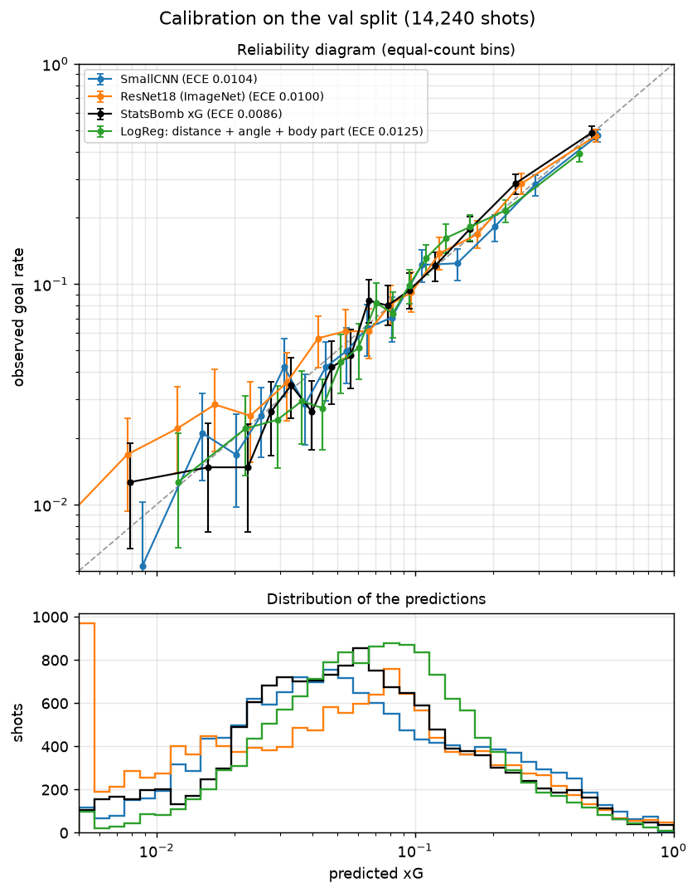
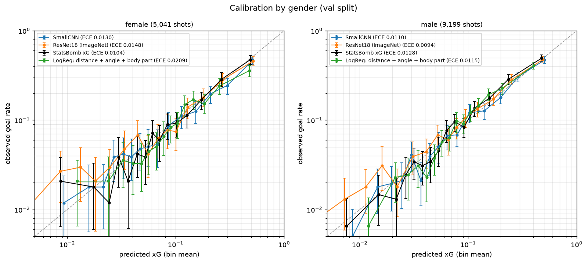

# Results on the val split

14,240 open-play shots from 593 matches, goal rate 0.1033. CNN rows are the seed-42 runs; the epoch of every CNN was selected on the validation split. Generated by `python -m src.evaluate --split val`.

## Metrics (all)

| model | log loss | Brier | ROC-AUC | mean xG | goal rate | shots |
|---|---|---|---|---|---|---|
| SmallCNN | 0.2656 | 0.0765 | 0.8108 | 0.1093 | 0.1033 | 14240 |
| ResNet18 (ImageNet) | 0.2690 | 0.0772 | 0.8060 | 0.0993 | 0.1033 | 14240 |
| ResNet18 (random init) | 0.2654 | 0.0762 | 0.8094 | 0.1050 | 0.1033 | 14240 |
| SmallCNN, no distance map | 0.2660 | 0.0766 | 0.8115 | 0.1032 | 0.1033 | 14240 |
| StatsBomb xG | 0.2629 | 0.0753 | 0.8138 | 0.1000 | 0.1033 | 14240 |
| Constant (train goal rate) | 0.3323 | 0.0926 | 0.5000 | 0.1031 | 0.1033 | 14240 |
| LogReg: distance + angle | 0.2942 | 0.0844 | 0.7454 | 0.1037 | 0.1033 | 14240 |
| LogReg: distance + angle + body part | 0.2853 | 0.0820 | 0.7708 | 0.1043 | 0.1033 | 14240 |

## Metrics (male)

| model | log loss | Brier | ROC-AUC | mean xG | goal rate | shots |
|---|---|---|---|---|---|---|
| SmallCNN | 0.2617 | 0.0755 | 0.8189 | 0.1075 | 0.1034 | 9199 |
| ResNet18 (ImageNet) | 0.2660 | 0.0765 | 0.8120 | 0.0970 | 0.1034 | 9199 |
| ResNet18 (random init) | 0.2623 | 0.0754 | 0.8164 | 0.1040 | 0.1034 | 9199 |
| SmallCNN, no distance map | 0.2619 | 0.0756 | 0.8206 | 0.1024 | 0.1034 | 9199 |
| StatsBomb xG | 0.2605 | 0.0749 | 0.8205 | 0.0967 | 0.1034 | 9199 |
| Constant (train goal rate) | 0.3324 | 0.0927 | 0.5000 | 0.1031 | 0.1034 | 9199 |
| LogReg: distance + angle | 0.2918 | 0.0840 | 0.7545 | 0.0984 | 0.1034 | 9199 |
| LogReg: distance + angle + body part | 0.2814 | 0.0809 | 0.7797 | 0.0981 | 0.1034 | 9199 |

## Metrics (female)

| model | log loss | Brier | ROC-AUC | mean xG | goal rate | shots |
|---|---|---|---|---|---|---|
| SmallCNN | 0.2728 | 0.0782 | 0.7959 | 0.1126 | 0.1032 | 5041 |
| ResNet18 (ImageNet) | 0.2746 | 0.0785 | 0.7954 | 0.1037 | 0.1032 | 5041 |
| ResNet18 (random init) | 0.2712 | 0.0775 | 0.7969 | 0.1070 | 0.1032 | 5041 |
| SmallCNN, no distance map | 0.2734 | 0.0785 | 0.7945 | 0.1046 | 0.1032 | 5041 |
| StatsBomb xG | 0.2673 | 0.0760 | 0.8022 | 0.1059 | 0.1032 | 5041 |
| Constant (train goal rate) | 0.3320 | 0.0925 | 0.5000 | 0.1031 | 0.1032 | 5041 |
| LogReg: distance + angle | 0.2986 | 0.0852 | 0.7310 | 0.1133 | 0.1032 | 5041 |
| LogReg: distance + angle + body part | 0.2925 | 0.0840 | 0.7563 | 0.1155 | 0.1032 | 5041 |

## Seeds (mean ± std over seeds)

| runs | group | n_seeds | log_loss | brier | roc_auc |
|---|---|---|---|---|---|
| SmallCNN | all | 3 | 0.2654 ± 0.0002 | 0.0764 ± 0.0001 | 0.8107 ± 0.0006 |
| SmallCNN | female | 3 | 0.2723 ± 0.0004 | 0.0779 ± 0.0003 | 0.7954 ± 0.0006 |
| SmallCNN | male | 3 | 0.2617 ± 0.0001 | 0.0755 ± 0.0001 | 0.8191 ± 0.0007 |
| SmallCNN, no distance map | all | 3 | 0.2655 ± 0.0005 | 0.0764 ± 0.0002 | 0.8115 ± 0.0001 |
| SmallCNN, no distance map | female | 3 | 0.2728 ± 0.0006 | 0.0781 ± 0.0003 | 0.7946 ± 0.0002 |
| SmallCNN, no distance map | male | 3 | 0.2615 ± 0.0007 | 0.0755 ± 0.0003 | 0.8207 ± 0.0001 |

## Test-time augmentation (mean of original and mirrored prediction; not used in the main rows)

| model | log loss | Brier | ROC-AUC | mean xG | goal rate | shots |
|---|---|---|---|---|---|---|
| SmallCNN | 0.2656 | 0.0765 | 0.8108 | 0.1093 | 0.1033 | 14240 |
| SmallCNN + mirror TTA | 0.2651 | 0.0764 | 0.8119 | 0.1093 | 0.1033 | 14240 |
| ResNet18 (ImageNet) | 0.2690 | 0.0772 | 0.8060 | 0.0993 | 0.1033 | 14240 |
| ResNet18 (ImageNet) + mirror TTA | 0.2677 | 0.0768 | 0.8077 | 0.0991 | 0.1033 | 14240 |

## Match-level bootstrap, 95% CIs (2000 resamples of matches)

| model | metric | value | 95% CI |
|---|---|---|---|
| SmallCNN | log_loss | 0.2656 | [0.2553, 0.2766] |
| SmallCNN | brier | 0.0765 | [0.0730, 0.0800] |
| SmallCNN | roc_auc | 0.8108 | [0.7977, 0.8219] |
| ResNet18 (ImageNet) | log_loss | 0.2690 | [0.2576, 0.2809] |
| ResNet18 (ImageNet) | brier | 0.0772 | [0.0737, 0.0808] |
| ResNet18 (ImageNet) | roc_auc | 0.8060 | [0.7926, 0.8173] |
| ResNet18 (random init) | log_loss | 0.2654 | [0.2549, 0.2765] |
| ResNet18 (random init) | brier | 0.0762 | [0.0727, 0.0797] |
| ResNet18 (random init) | roc_auc | 0.8094 | [0.7965, 0.8205] |
| SmallCNN, no distance map | log_loss | 0.2660 | [0.2557, 0.2767] |
| SmallCNN, no distance map | brier | 0.0766 | [0.0731, 0.0802] |
| SmallCNN, no distance map | roc_auc | 0.8115 | [0.7986, 0.8228] |
| StatsBomb xG | log_loss | 0.2629 | [0.2522, 0.2740] |
| StatsBomb xG | brier | 0.0753 | [0.0719, 0.0790] |
| StatsBomb xG | roc_auc | 0.8138 | [0.7997, 0.8253] |
| LogReg: distance + angle | log_loss | 0.2942 | [0.2831, 0.3054] |
| LogReg: distance + angle | brier | 0.0844 | [0.0807, 0.0883] |
| LogReg: distance + angle | roc_auc | 0.7454 | [0.7318, 0.7578] |
| LogReg: distance + angle + body part | log_loss | 0.2853 | [0.2744, 0.2966] |
| LogReg: distance + angle + body part | brier | 0.0820 | [0.0783, 0.0858] |
| LogReg: distance + angle + body part | roc_auc | 0.7708 | [0.7578, 0.7828] |

### Paired differences a − b (negative log loss / Brier and positive AUC favour a)

**all shots**

| a | b | metric | diff | 95% CI | share of resamples where a is better |
|---|---|---|---|---|---|
| SmallCNN | StatsBomb xG | log_loss | +0.0027 | [+0.0003, +0.0051] | 0.013 |
| SmallCNN | StatsBomb xG | brier | +0.0011 | [+0.0004, +0.0019] | 0.002 |
| SmallCNN | StatsBomb xG | roc_auc | -0.0030 | [-0.0083, +0.0024] | 0.137 |
| SmallCNN | ResNet18 (ImageNet) | log_loss | -0.0034 | [-0.0060, -0.0010] | 0.999 |
| SmallCNN | ResNet18 (ImageNet) | brier | -0.0007 | [-0.0014, +0.0000] | 0.966 |
| SmallCNN | ResNet18 (ImageNet) | roc_auc | +0.0048 | [+0.0002, +0.0092] | 0.979 |
| SmallCNN | LogReg: distance + angle + body part | log_loss | -0.0197 | [-0.0234, -0.0163] | 1.000 |
| SmallCNN | LogReg: distance + angle + body part | brier | -0.0055 | [-0.0068, -0.0043] | 1.000 |
| SmallCNN | LogReg: distance + angle + body part | roc_auc | +0.0401 | [+0.0333, +0.0472] | 1.000 |
| ResNet18 (ImageNet) | ResNet18 (random init) | log_loss | +0.0036 | [+0.0013, +0.0058] | 0.001 |
| ResNet18 (ImageNet) | ResNet18 (random init) | brier | +0.0010 | [+0.0004, +0.0016] | 0.002 |
| ResNet18 (ImageNet) | ResNet18 (random init) | roc_auc | -0.0034 | [-0.0077, +0.0010] | 0.065 |
| SmallCNN | SmallCNN, no distance map | log_loss | -0.0004 | [-0.0019, +0.0013] | 0.654 |
| SmallCNN | SmallCNN, no distance map | brier | -0.0001 | [-0.0006, +0.0004] | 0.648 |
| SmallCNN | SmallCNN, no distance map | roc_auc | -0.0006 | [-0.0039, +0.0026] | 0.351 |

**by gender, main pair**

| a | b | metric | diff | group | 95% CI | share of resamples where a is better |
|---|---|---|---|---|---|---|
| SmallCNN | StatsBomb xG | log_loss | +0.0055 | female | [+0.0011, +0.0097] | 0.006 |
| SmallCNN | StatsBomb xG | brier | +0.0022 | female | [+0.0010, +0.0034] | 0.000 |
| SmallCNN | StatsBomb xG | roc_auc | -0.0063 | female | [-0.0162, +0.0045] | 0.123 |
| SmallCNN | StatsBomb xG | log_loss | +0.0012 | male | [-0.0019, +0.0042] | 0.230 |
| SmallCNN | StatsBomb xG | brier | +0.0006 | male | [-0.0004, +0.0015] | 0.128 |
| SmallCNN | StatsBomb xG | roc_auc | -0.0017 | male | [-0.0080, +0.0049] | 0.322 |

## Calibration

Equal-count bins (15); ECE = shot-weighted mean |mean prediction − goal rate| over the bins.

| model | ECE | ECE female | ECE male |
|---|---|---|---|
| SmallCNN | 0.0104 | 0.0130 | 0.0110 |
| ResNet18 (ImageNet) | 0.0100 | 0.0148 | 0.0094 |
| StatsBomb xG | 0.0086 | 0.0104 | 0.0128 |
| LogReg: distance + angle + body part | 0.0125 | 0.0209 | 0.0115 |

