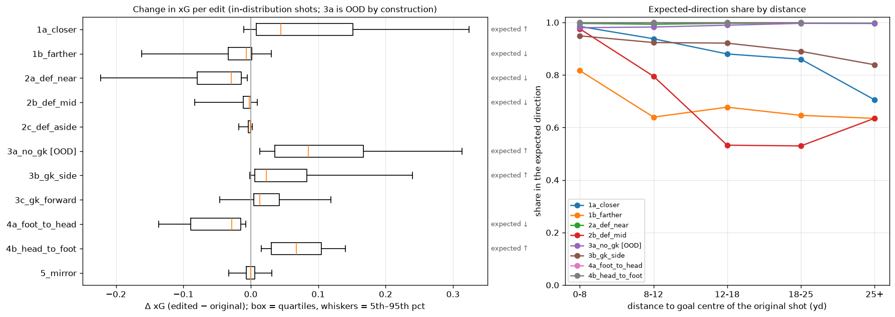
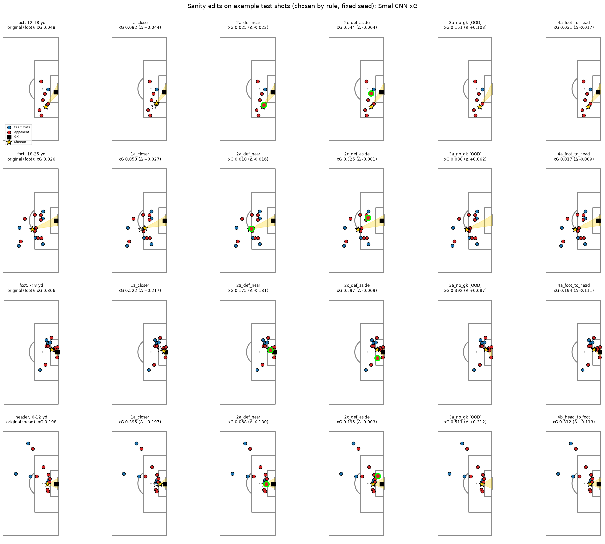
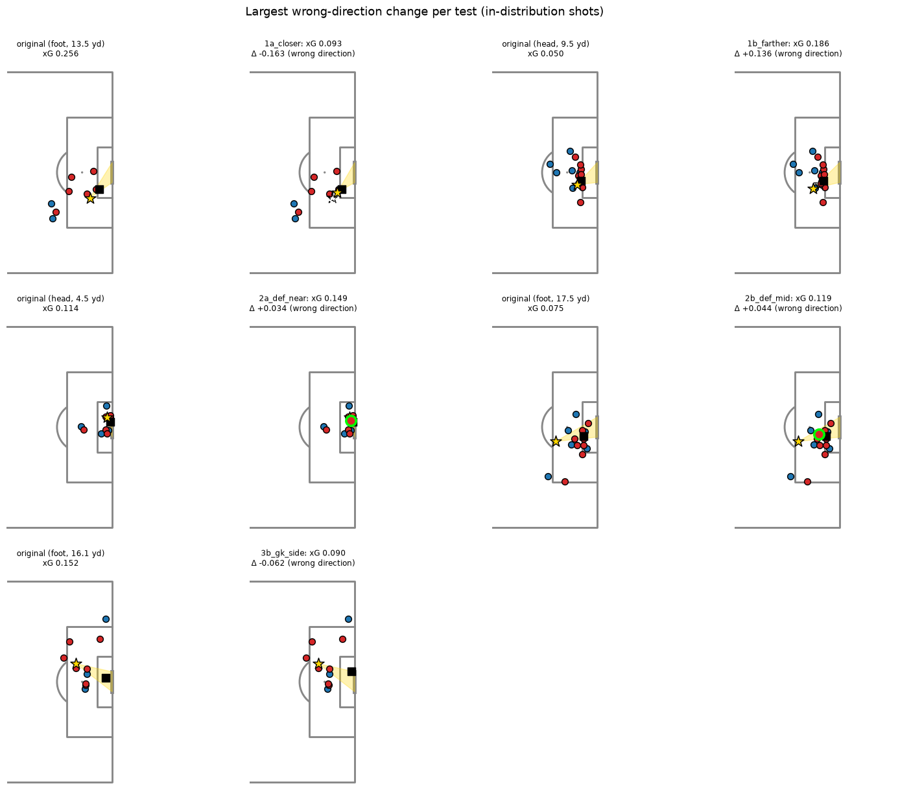

# Sanity tests of SmallCNN on the test split

14,166 open-play shots; model `small_cnn` (seed 42). Each shot is edited, re-rendered and re-scored; Δ = edited − original. |Δp| < 0.001 counts as no change. Shares and means are over in-distribution rows; OOD rows (no goalkeeper, headers from 25+ yd) are counted in the `OOD` column and reported separately below. Generated by `python -m src.sanity --split test`.

## Summary

| test | description | shots | OOD | expected direction | no change | opposite | mean Δp | median Δp | mean Δlogit |
|---|---|---|---|---|---|---|---|---|---|
| 1a_closer | Shooter 3 yd closer to the goal centre | 13929 | 20 | 0.852 | 0.030 | 0.118 | 0.091 | 0.044 | 0.755 |
| 1b_farther | Shooter 3 yd farther from the goal centre | 14160 | 22 | 0.667 | 0.062 | 0.271 | -0.027 | -0.007 | -0.251 |
| 2a_def_near | Defender added 1.5 yd in front of the shooter, on the shot line | 14163 | 20 | 0.996 | 0.002 | 0.002 | -0.061 | -0.029 | -0.963 |
| 2b_def_mid | Defender added halfway along the shot line | 14166 | 20 | 0.640 | 0.170 | 0.190 | -0.014 | -0.002 | -0.116 |
| 2c_def_aside | Control: the halfway defender moved 6 yd sideways, outside the cone | 14166 | 20 | – | – | – | -0.003 | -0.001 | -0.036 |
| 3a_no_gk [OOD] | Goalkeeper removed | 14147 | 14147 | 0.991 | 0.001 | 0.008 | 0.114 | 0.085 | 1.059 |
| 3b_gk_side | Goalkeeper moved 3 yd sideways, away from the shot line | 10844 | 1 | 0.894 | 0.047 | 0.059 | 0.059 | 0.023 | 0.500 |
| 3c_gk_forward | Goalkeeper moved 3 yd towards the shooter (descriptive) | 13331 | 1 | – | – | – | 0.024 | 0.014 | 0.333 |
| 4a_foot_to_head | Body part foot -> head (same position) | 11786 | 3282 | 1.000 | 0.000 | 0.000 | -0.050 | -0.028 | -0.551 |
| 4b_head_to_foot | Body part head -> foot (same position) | 2337 | 2 | 1.000 | 0.000 | 0.000 | 0.071 | 0.068 | 0.596 |
| 5_mirror | Mirror image (y -> 80 - y) | 14166 | 20 | – | – | – | -0.000 | -0.000 | -0.007 |

## Control defender (2c)

Criterion: per shot, the defender beside the shot line changes xG less than the same defender in front of the shooter (2a) and halfway along the line (2b).

| shots | |Δ2c| < |Δ2a| | |Δ2c| < |Δ2b| | |Δ2c| < both (criterion) | mean Δ2c | share Δ2c < 0 |
|---|---|---|---|---|---|
| 14143 | 0.998 | 0.815 | 0.814 | -0.003 | 0.844 |

## Expected-direction share by distance band (original shot distance)

| test | 0-8 yd | 8-12 yd | 12-18 yd | 18-25 yd | 25+ yd |
|---|---|---|---|---|---|
| 1a_closer | 0.985 | 0.938 | 0.880 | 0.860 | 0.705 |
| 1b_farther | 0.816 | 0.640 | 0.677 | 0.646 | 0.635 |
| 2a_def_near | 0.996 | 0.993 | 0.997 | 0.998 | 0.997 |
| 2b_def_mid | 0.975 | 0.795 | 0.533 | 0.530 | 0.635 |
| 3a_no_gk [OOD] | 0.980 | 0.982 | 0.989 | 0.996 | 0.996 |
| 3b_gk_side | 0.949 | 0.923 | 0.921 | 0.890 | 0.839 |
| 4a_foot_to_head | 1.000 | 1.000 | 1.000 | 1.000 | – |
| 4b_head_to_foot | 1.000 | 1.000 | 1.000 | 1.000 | – |

## CNN vs. LogReg (distance + angle + body part) on the edits it can see

| test | shots | CNN expected | CNN mean Δp | LogReg expected | LogReg mean Δp |
|---|---|---|---|---|---|
| 1a_closer | 13909 | 0.852 | 0.091 | 0.997 | 0.063 |
| 1b_farther | 14138 | 0.667 | -0.027 | 0.997 | -0.037 |
| 4a_foot_to_head | 8504 | 1.000 | -0.050 | 1.000 | -0.086 |
| 4b_head_to_foot | 2335 | 1.000 | 0.071 | 1.000 | 0.176 |

## Goalkeeper 3 yd forward (3c, descriptive, no expected direction)

| band | shots | mean Δp | median Δp | share up | share down |
|---|---|---|---|---|---|
| 0-8 | 881 | -0.021 | -0.006 | 0.435 | 0.552 |
| 8-12 | 2091 | 0.039 | 0.032 | 0.791 | 0.193 |
| 12-18 | 3459 | 0.045 | 0.040 | 0.891 | 0.101 |
| 18-25 | 3638 | 0.022 | 0.016 | 0.953 | 0.035 |
| 25+ | 3261 | 0.007 | 0.006 | 0.914 | 0.027 |

## Mirror symmetry (5)

The input of the mirrored shot is exactly the row-flipped tensor, so any difference is an asymmetry learned by the model.

| shots | mean |Δp| | median |Δp| | 95th pct |Δp| | max |Δp| | mean |Δlogit| | share |Δp| < 0.01 |
|---|---|---|---|---|---|---|
| 14166 | 0.0122 | 0.0062 | 0.0451 | 0.1526 | 0.1628 | 0.6429 |

## Unexpected behaviour

### Out-of-distribution situations

These edits create situations (almost) absent from training; results here say little about the model's football logic.

| test | OOD reason | shots | mean Δp | expected direction |
|---|---|---|---|---|
| 1a_closer | header from 25+ yd | 1 | 0.003 | 1.000 |
| 1a_closer | no goalkeeper | 19 | 0.107 | 0.789 |
| 1b_farther | header from 25+ yd | 3 | -0.007 | 0.667 |
| 1b_farther | no goalkeeper | 19 | -0.041 | 0.737 |
| 2a_def_near | header from 25+ yd | 1 | -0.022 | 1.000 |
| 2a_def_near | no goalkeeper | 19 | -0.131 | 1.000 |
| 2b_def_mid | header from 25+ yd | 1 | -0.010 | 1.000 |
| 2b_def_mid | no goalkeeper | 19 | -0.037 | 0.895 |
| 2c_def_aside | header from 25+ yd | 1 | -0.000 | – |
| 2c_def_aside | no goalkeeper | 19 | -0.006 | – |
| 3a_no_gk | header from 25+ yd; no goalkeeper | 1 | 0.059 | 1.000 |
| 3a_no_gk | no goalkeeper | 14146 | 0.114 | 0.991 |
| 3b_gk_side | header from 25+ yd | 1 | 0.053 | 1.000 |
| 3c_gk_forward | header from 25+ yd | 1 | 0.001 | – |
| 4a_foot_to_head | header from 25+ yd | 3264 | -0.007 | 0.999 |
| 4a_foot_to_head | header from 25+ yd; no goalkeeper | 8 | -0.041 | 1.000 |
| 4a_foot_to_head | no goalkeeper | 10 | -0.099 | 1.000 |
| 4b_head_to_foot | header from 25+ yd | 1 | 0.019 | 1.000 |
| 4b_head_to_foot | no goalkeeper | 1 | 0.044 | 1.000 |
| 5_mirror | header from 25+ yd | 1 | 0.003 | – |
| 5_mirror | no goalkeeper | 19 | 0.005 | – |

### In-distribution: moving the shooter also moves them relative to the defenders

The other players stay in place, so a 3 yd move can bring the shooter into (or out of) a defender's reach. Wrong-direction changes concentrate where the move changes the distance to the nearest outfield opponent:

| test | nearest outfield opponent | shots | expected | opposite | mean Δp |
|---|---|---|---|---|---|
| 1a_closer | away from opponents (> 1 yd) | 3284 | 0.947 | 0.048 | 0.164 |
| 1a_closer | closer to an opponent (> 1 yd) | 5245 | 0.699 | 0.241 | 0.028 |
| 1a_closer | within ±1 yd | 5380 | 0.942 | 0.042 | 0.109 |
| 1b_farther | away from opponents (> 1 yd) | 9919 | 0.585 | 0.337 | -0.012 |
| 1b_farther | closer to an opponent (> 1 yd) | 998 | 0.930 | 0.054 | -0.079 |
| 1b_farther | within ±1 yd | 3221 | 0.837 | 0.135 | -0.057 |

### In-distribution: a defender halfway along the shot line sometimes raises xG

| added defender to GK | shots | share up (wrong) | share down | mean Δp |
|---|---|---|---|---|
| 0-3 yd | 3143 | 0.073 | 0.902 | -0.044 |
| 3-6 yd | 4082 | 0.343 | 0.546 | -0.009 |
| 6-10 yd | 3663 | 0.265 | 0.506 | -0.003 |
| 10-20 yd | 3226 | 0.027 | 0.653 | -0.003 |
| 20-inf yd | 32 | 0.000 | 0.969 | -0.009 |

### In-distribution: largest changes in the wrong direction

| edit | i | shot_id | distance | body_part | p_orig | p | dp | dlogit | player_within_1yd |
|---|---|---|---|---|---|---|---|---|---|
| 1a_closer | 11695 | 7e762ab0-206e-47eb-a68a-cf6a05f359f6 | 13.537 | Right Foot | 0.256 | 0.093 | -0.163 | -1.211 | False |
| 1a_closer | 8881 | 53f9216a-f715-4911-8424-36e3550ae40e | 14.063 | Left Foot | 0.442 | 0.213 | -0.230 | -1.077 | False |
| 1a_closer | 6990 | 2d1250c5-51db-487c-8294-85e31a0ee9d0 | 8.902 | Right Foot | 0.184 | 0.072 | -0.112 | -1.065 | False |
| 1a_closer | 1227 | 50794813-3688-4c79-9982-824b41af1b1f | 30.783 | Right Foot | 0.011 | 0.004 | -0.007 | -1.057 | True |
| 1a_closer | 7874 | 6b2dbad2-c4fc-431a-babb-3e2a49e563ba | 16.671 | Right Foot | 0.358 | 0.163 | -0.195 | -1.055 | False |
| 1b_farther | 635 | 5f0e89a2-40a8-4410-8706-d71f1f3c776b | 9.467 | Head | 0.050 | 0.186 | 0.136 | 1.460 | True |
| 1b_farther | 5533 | ed99dad8-b056-4756-89c5-bc14ce0e891b | 15.967 | Right Foot | 0.078 | 0.252 | 0.173 | 1.375 | False |
| 1b_farther | 7263 | e9e8d6c5-6490-4330-94c0-d2938124d7b9 | 19.233 | Right Foot | 0.085 | 0.256 | 0.171 | 1.305 | False |
| 1b_farther | 13691 | f9c72daa-23ed-4f75-a41d-effb48be3b0e | 14.417 | Left Foot | 0.047 | 0.136 | 0.090 | 1.173 | False |
| 1b_farther | 4245 | d0e1be1a-92ee-49ce-b32d-d0a7d28f40b8 | 7.446 | Head | 0.088 | 0.238 | 0.150 | 1.172 | False |
| 2a_def_near | 13934 | 6420092f-e59a-4ed1-9018-2f37a1cc7427 | 4.478 | Head | 0.114 | 0.149 | 0.034 | 0.300 | True |
| 2a_def_near | 1255 | 0a8ee8f7-0aec-4812-a1ce-b27fcef37e57 | 9.159 | Head | 0.055 | 0.072 | 0.017 | 0.294 | True |
| 2a_def_near | 11330 | f39196ac-f8f2-4652-9562-592c220c91f1 | 9.590 | Left Foot | 0.100 | 0.121 | 0.021 | 0.213 | False |
| 2a_def_near | 12746 | 6d6c40d7-86dc-4a87-91eb-6efd6f38d7d3 | 10.337 | Right Foot | 0.056 | 0.064 | 0.008 | 0.142 | False |
| 2a_def_near | 6591 | 35e7d8c4-ca3d-4db7-8a66-82a070c55cba | 9.301 | Head | 0.036 | 0.041 | 0.005 | 0.138 | False |
| 2b_def_mid | 12018 | b2cceb50-9aaf-43c6-b26f-5ef0c3544793 | 17.457 | Right Foot | 0.075 | 0.119 | 0.044 | 0.511 | False |
| 2b_def_mid | 6033 | 057d4f33-a6ae-42de-a01c-9dd893162004 | 22.201 | Right Foot | 0.098 | 0.149 | 0.050 | 0.471 | False |
| 2b_def_mid | 11353 | 1a02f8ed-f48e-47e1-973b-8059a74e10a4 | 18.208 | Left Foot | 0.125 | 0.179 | 0.055 | 0.428 | False |
| 2b_def_mid | 13674 | 510e45f3-d02e-41d5-bc05-32f765761ecf | 25.248 | Left Foot | 0.016 | 0.023 | 0.007 | 0.388 | False |
| 2b_def_mid | 2763 | 1cb4e948-5a00-40dc-9835-a3198f1527f0 | 16.403 | Right Foot | 0.081 | 0.114 | 0.033 | 0.380 | False |
| 3b_gk_side | 9269 | cf07653f-4926-4243-be1a-a1c6219d587e | 16.100 | Right Foot | 0.152 | 0.090 | -0.062 | -0.600 | False |
| 3b_gk_side | 13583 | 3d6b0dfa-56ec-42c5-8266-b71e49b839cf | 13.375 | Head | 0.221 | 0.135 | -0.086 | -0.597 | False |
| 3b_gk_side | 10583 | 6d545c1f-2ef9-41bf-8b7d-d9fb46fc7bcc | 24.427 | Right Foot | 0.058 | 0.035 | -0.023 | -0.525 | False |
| 3b_gk_side | 12546 | f8e8540e-b7df-4b27-a823-c2760174cff7 | 12.027 | Right Foot | 0.173 | 0.115 | -0.058 | -0.475 | False |
| 3b_gk_side | 9385 | 79b0c881-73b6-4aa3-9f12-2ebdeb396d09 | 8.062 | Left Foot | 0.218 | 0.148 | -0.070 | -0.473 | False |

